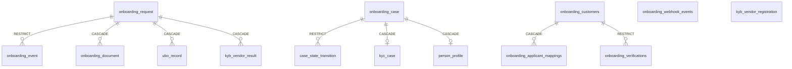

# CRM database audit — 1. Inventory and canonical schema

**Part 1 of 4.** [1 Inventory](inventory.md) · [2 Audit](audit.md) ·
[3 Options](options.md) · [4 Migration plan](migration-plan.md)

| | |
|---|---|
| Date | 12 October 2026 |
| Code | branch `feature/filters` @ `a36d10c`, clean tree |
| Database inspected | `aner_settlement` on `aner-postgres` (`localhost:5433`), PostgreSQL 16.14, a **development** database, `pg_is_in_recovery() = false`, at `onboarding_0053_auto_criteria` (head) |
| Access | Read only. Every query ran with `default_transaction_read_only=on` or was a `pg_dump --schema-only`. No migration, DDL or DML was run on any database |
| Deliverables in this file | A (artifact inventory), B (canonical schema baseline: table inventory, ERD, column and constraint inventory, migration map, conflicts) |

`docs/database.md` remains the working reference for the database. It was last verified
at `onboarding_0043` (5 October). This audit covers 0044–0053 as well, and §7 lists where
`database.md` and the migration register are now out of date.

---

## 1. Scope — the eight questions in §1.2

| # | Question | Answer | Evidence |
|---|---|---|---|
| 1 | Engine and version | PostgreSQL 16 (16.14 locally). Extensions: `plpgsql` and `btree_gist` (installed in `public`). No CRM object uses `btree_gist` | `docs/database.md` §1; `pg_proc` listing |
| 2 | Database and schema | One database (`aner_settlement` locally) for the whole platform. The CRM lives in schema **`onboarding`**, and reads `auth` and writes `audit` through facades | `backend/.env`; `migrations/env.py` `MODULE_SCHEMAS` |
| 3 | Own database or shared? | **Shared database, own schema.** Fifteen module schemas plus `public` (`alembic_version`, `prevent_mutation()`). The CRM shares the `onboarding` schema with an older system, the legacy onboarding-request path (§5.2) | `pg_class` counts per schema |
| 4 | Model registration and migration | SQLAlchemy 2 declarative `Base` (`app/platform/database/models.py`) with two bases: `AnerModel` (id, created_at, updated_at) and `AppendOnlyModel` (id, created_at). `migrations/env.py` imports every entity module so `Base.metadata` is complete. Migrations run through `alembic upgrade head` | `migrations/env.py` lines 6–33 |
| 5 | Several migration directories? | **Yes, 18 `version_locations`** in `alembic.ini` (one per module plus three platform packages), forming **one chain with one head**. CRM revisions are in `app/modules/onboarding/migrations/` (53 numbered, plus 3 hash-named revisions from the legacy era) and `app/platform/authentication/migrations/` (`auth_0005`–`auth_0010` are CRM permission seeds) | `alembic heads` → `onboarding_0053_auto_criteria (head)`; `alembic history` → 120 revisions |
| 6 | Competing definitions of one table? | **No duplicate table definitions.** Each of the 49 `onboarding` tables has exactly one model and one creating migration. Model and database disagree in small ways that `alembic check` does not see: one primary key, 12 CHECK constraints and some server defaults (§7) | `__tablename__` grep; the script in §7.2 |
| 7 | Reference-only schema files? | No `.sql` DDL file defines the schema. `backend/scripts/crm_data_inventory.sql` is a **read-only** query script. `docs/database.md` and `docs/contracts/*.md` are reference documents, not executable | `find -name '*.sql'` |
| 8 | Can migrations rebuild from empty? | **Yes, by design and in practice.** There is no `create_all`, and tests run against a database built by `alembic upgrade head`. Three databases on this server, built at different times and upgraded along different paths, give **byte-identical** `pg_dump --schema-only` output for `onboarding` and `auth` (only the random `\restrict` token differs). One limit: an *upgrade* from a database older than `onboarding_0014` that holds CRM rows **refuses to run** unless `E9_ALLOW_CRM_RESET=1`, which empties five CRM tables (approved for development only) | `diff` of three dumps; `onboarding_0014_company_record.py` docstring |

---

## 2. Deliverable A — artifact inventory

| Artifact | Location | Purpose | Current relevance | Evidence / notes |
|---|---|---|---|---|
| Alembic config | `backend/alembic.ini` | 18 version locations on one line | **Active** | `tests/contract/test_migration_discovery.py` derives the list from the filesystem |
| Alembic env | `backend/migrations/env.py` | Registers every model; limits autogenerate to `MODULE_SCHEMAS`; ignores `cases.case_reference_sequence` | **Active** | — |
| Root revision | `backend/migrations/versions/` (17 files) | `a0b1c2d3e4f5` creates `public.prevent_mutation()`; platform merges | **Active** | Every append-only trigger depends on it |
| CRM migrations | `backend/app/modules/onboarding/migrations/` | `onboarding_0001` … `0053`, plus `45ede5960506`, `e849a8d1c41e`, `f1c7a3e6b9d2` | **Active** | 0001–0004 and the three hash revisions belong to the legacy path; CRM tables start at 0005 |
| Auth migrations | `backend/app/platform/authentication/migrations/` | `auth_0001`–`auth_0010` | **Active**; 0005–0010 seed CRM permissions | `auth_0004_rbac` creates `auth.role` and `auth.role_permission` |
| Declarative base | `backend/app/platform/database/models.py` | `Base`, `AnerModel`, `AppendOnlyModel` | **Active** | The base class alone enforces nothing; triggers do |
| CRM entities | `backend/app/modules/onboarding/domain/entities/*.py` (49 model classes in 38 files, plus enum files) | ORM for all 49 `onboarding` tables | **Active** (35 CRM, 14 legacy) | §5 |
| Auth / RBAC models | `app/platform/authentication/models.py`, `app/platform/authorization/models.py` | `users`, `refresh_tokens`, `role`, `role_permission` | **Active** | CRM stores actor ids as text and resolves names through the auth facade |
| Audit model | `app/modules/audit/domain/entities/audit.py` | `audit.audit_events` | **Active** | The CRM writes access events through `AuditService` (§6.3 of the audit) |
| Repositories | `app/modules/onboarding/infrastructure/repositories/*.py` | Typed access per table | **Active** | Several CRM services query models directly, without a repository |
| Services | `app/modules/onboarding/application/*.py` | Every write; one transaction per operation | **Active** | Owners are listed per table in the audit, §3 |
| API routers | `app/modules/onboarding/api/*.py`, mounted by `api/router.py` under `/api/v1/onboarding` | 18 CRM routers plus the CRM's four `/verifications*` routes in `router.py`; **9 legacy routes are still mounted** (five `/cases…`, `/register`, `/{id}/sdk-token`, `/{id}/status`, `/webhooks/sumsub`) | **Active** | `api/router.py` lines 171–394 (legacy), 464–584 (verifications) |
| Pydantic schemas | `app/modules/onboarding/api/schemas/*.py` | API contracts over the tables | **Active** | `frontend/src/lib/api/schema.ts` is generated from OpenAPI |
| Temporal workflow | `app/modules/onboarding/workflows/onboarding_workflow.py`, `application/activities.py` | The legacy onboarding-request workflow | **Dormant.** The worker is not started (`app/main.py` line 106: "run_worker() was removed") | Writes `onboarding_request`, `onboarding_event`, `ubo_record`, `onboarding_document`, `kyb_vendor_result` |
| Startup seed | `app/bootstrap.py` `load_kyb_vendor_registry_seed_data` | Loads `kyb_vendor_registration` from config | **Runs on every start; loads nothing** ("a no-op until Epic 4.1 ships real adapters") | 0 rows |
| Data commands | `backfill_relationship_managers.py`, `backfill_trade_relationships.py`, `migrate_deal_buyers.py`, `command_console.py` | One-off data moves | **Built; not run on any live database** (`remaining-work.md` OPS-0 … OPS-6) | Each has `--dry-run`, `--apply`, `--validate` |
| Sample data | `sample_data*.py` (6 files) | Seed through the real services | **Active** (development) | `sample_data_deals.py` still writes legacy `deal_buyer` rows |
| Raw SQL | `backend/scripts/crm_data_inventory.sql`; `text()` in 17 entity files (CHECK and index expressions), the three data commands, and test fixtures | Read-only sizing; DDL fragments | **Active** | Tests insert legacy `onboarding_request` and `ubo_record` rows with raw SQL (`test_sanctions_screening.py:249`, `test_company_groups.py:124`) |
| DB functions | `public.prevent_mutation()`; `onboarding.prevent_field_mutation_when_set`, `prevent_terminal_deal_change`, `prevent_reviewed_verification_outcome_change`, `prevent_gst_registration_delete`, `prevent_company_address_delete`, `prevent_company_group_cycle` | Append-only and set-once rules | **Active** | 41 triggers on `onboarding` |
| Views, procedures | — | None in `onboarding` or `auth` | — | — |
| Contract tests | `backend/tests/contract/test_orm_matches_the_onboarding_schema.py`, `test_migration_discovery.py`, `test_module_independence.py` | Drift and boundary checks | **Active** | The ORM test uses Alembic's comparison, which skips primary keys, CHECK constraints and server defaults (§7.2) |
| CRM tests | `app/modules/onboarding/tests/` | `pytest --crm` collects these minus 23 legacy files (`backend/conftest.py` `_LEGACY_ONBOARDING_TESTS`) | **Active** | — |
| Reference docs | `docs/database.md`, `docs/contracts/*.md` (10 contracts), `docs/architecture.md`, `docs/remaining-work.md`, `docs/feedback-plan.md` | Intent, rules, open items | **Active, partly stale** | §7.3 |
| Second Postgres container | `e9-postgres` on `localhost:5556` | Unknown | **Not inspected** | Outside this repository's configuration |

### Sources of truth

| Question | Authority | Notes |
|---|---|---|
| What exists in a database | The migration chain | Model metadata is secondary: it omits 12 CHECK constraints and differs on one primary key (§7.2) |
| What the application thinks exists | `Base.metadata` via `migrations/env.py` | `alembic check` reports **no drift** for what it compares (run 12 Oct) |
| Why it is shaped this way | `docs/architecture.md`, `docs/contracts/*` | — |
| Migration order and rules | `docs/contracts/migration-register.md` | **Stops at 0043** (§7.3) |
| What is still owed | `docs/remaining-work.md` | The tracker for deferred data moves (OPS-0 … OPS-6) |

---

## 3. Migration dependency map

One linear Alembic chain serves the whole platform: 120 revisions, one head. Its first
part has 13 historical merge points from other modules' branches, which resolve
correctly; the register (§2) forbids adding more. Since `onboarding_0007` the chain is
**strictly linear**.

The CRM numbers do **not** run in numeric order, because lanes were re-parented when
they merged:

| Revision | Tables created | Columns / rules added to existing tables | Data |
|---|---|---|---|
| 0001 | `onboarding_customers`, `onboarding_applicant_mappings`, `onboarding_verifications`, `onboarding_webhook_events`, `onboarding_case`, `person_profile`, `kyc_case`, `case_state_transition` | — | — |
| 0002 | `onboarding_request`, `ubo_record`, `onboarding_document`, `onboarding_event`, `kyb_vendor_result` | — | — |
| 0003 | `kyb_vendor_registration` | — | — |
| 0005 | `exporter_profile`, `exporter_contact`, `exporter_activity` | — | — |
| 0006 | `verification_result` | — | — |
| 0010 | `screening_review_item`, `bank_activity_finding` | — | — |
| 0011 | `exporter_lifecycle_history` | append-only triggers | — |
| 0013 | — | history: `dimension`, `deal_id`, `reason` | `dimension` filled by a column default (no UPDATE) |
| 0014 | `exporter_gstin` | profile identity, PAN unique, marker; real FKs; drops `exporter_profile.gstin` | **TRUNCATE of 5 tables, behind a guard** |
| 0015 | `background_check_decision`, `background_check_evidence` | gauge on profile | — |
| 0016 | `follow_up_completion` | conversation gauge | — |
| 0017 | `qualification_criterion`, `qualification_reason_code`, `qualification_result`, `qualification_outcome` | journey, qualification | seed criteria |
| 0018 | `deal`, `deal_buyer` | — | — |
| 0019 | `crm_document` | — | — |
| 0020 | — | drops the ten-status `lifecycle_status` | — |
| 0021 | `verification_review` | result immutability triggers | copies legacy review columns into the chain |
| 0025 | `check_cycle` | `cycle_id` on results, items, decisions | inserts cycle 1 |
| 0026 | `background_check_proposal`, `background_check_proposal_resolution` | decision `proposal_id`, `approved_by/at` | — |
| 0030 | `deal_required_document` | — | seed one requirement |
| 0037 | `trade_relationship`, `trade_invoice`, `trade_invoice_outcome` | — | — |
| 0038 | `deal_buyer_company_map` | — | — |
| 0044 | — | profile: `background_check_reviewer_id`, `…_assigned_at` | — |
| 0045 | — | document: `preview_status`, `preview_storage_key` | — |
| 0046 | — | contact: `status`, `status_changed_at`, `status_reason`, `last_verified_*` | — |
| 0047 | `company_address` | `exporter_gstin.address_id` (composite FK) | — |
| 0048 | `company_bank_account` | — | — |
| 0049 | `payment_term` | profile `default_payment_term_id`; deal `value_amount`, `currency`, `payment_term_id`, override reason | seed terms |
| 0050 | — | profile `collections_owner_user_id` | — |
| 0051 | — | profile `parent_company_id`, `group_relationship`; group-cycle trigger | — |
| 0052 | `sanctions_list`, `sanctions_run`, `sanctions_run_list`, `sanctions_hit`, `sanctions_disposition` | — | seed lists |
| 0053 | — | criterion `auto_source` | — |

Revisions not listed here (0004, 0007–0009, 0012, 0022–0024, 0027–0029, 0031–0036,
0039–0043) change columns, constraints, triggers or data only. Their full descriptions
are in `migration-register.md` §1, up to 0043.

**No table was dropped and recreated, and no table was renamed, anywhere in the chain.**
Superseded designs were retired by dropping columns (`exporter_profile.gstin` in 0014,
`lifecycle_status` in 0020), never tables. That is why the legacy tables are still
present.

---

## 4. Canonical table inventory (summary)

**49 tables in `onboarding`**: 35 belong to the CRM and 14 to the legacy path. The CRM
also depends on 3 `auth` tables and 1 `audit` table, which other modules own. The
**optimisation scope is the 49**. Platform tables are noted but not redesigned (module
rule: the CRM may not edit other modules).

Base: **A** = `AnerModel` (mutable, has `updated_at`); **AO** = `AppendOnlyModel`.
Guard: **AO-trg** = `prevent_mutation()` refuses UPDATE and DELETE; **set-once** =
`prevent_field_mutation_when_set`; **no-del** = DELETE refused.

### 4.1 CRM tables (35)

| # | Table | Created | Base | DB guard | Rows (dev) | Kind |
|---|---|---|---|---|---|---|
| 1 | `exporter_profile` | 0005 | A | set-once `source`; group-cycle trigger | 128 | entity (company) + cached gauges |
| 2 | `exporter_gstin` | 0014 | A | no-del | 110 | entity (GST branch) |
| 3 | `company_address` | 0047 | A | no-del | 0 | entity |
| 4 | `exporter_contact` | 0005 | A | — | 181 | entity |
| 5 | `company_bank_account` | 0048 | A | — | 0 | entity + approval workflow state |
| 6 | `payment_term` | 0049 | A | — | 11 | versioned configuration |
| 7 | `exporter_lifecycle_history` | 0011 | AO | AO-trg | 1,898 | audit history (shared) |
| 8 | `exporter_activity` | 0005 | AO | AO-trg | 486 | event / note |
| 9 | `follow_up_completion` | 0016 | AO | AO-trg | 87 | workflow record (1:1 activity) |
| 10 | `qualification_criterion` | 0017 | AO | AO-trg | 9 | versioned configuration |
| 11 | `qualification_reason_code` | 0017 | A | — | 9 | lookup |
| 12 | `qualification_result` | 0017 | AO | AO-trg | 511 | evidence record |
| 13 | `qualification_outcome` | 0017 | AO | AO-trg | 75 | decision chain |
| 14 | `check_cycle` | 0025 | AO | AO-trg | 67 | workflow period |
| 15 | `background_check_decision` | 0015 | AO | AO-trg | 94 | decision chain |
| 16 | `background_check_evidence` | 0015 | AO | AO-trg | 693 | association (decision ↔ evidence) |
| 17 | `background_check_proposal` | 0026 | AO | AO-trg | 44 | approval request |
| 18 | `background_check_proposal_resolution` | 0026 | AO | AO-trg | 41 | approval outcome (1:1 proposal) |
| 19 | `verification_result` | 0006 | A | no-del; 3 set-once / freeze triggers | 187 | evidence record |
| 20 | `verification_review` | 0021 | AO | AO-trg | 11 | review chain |
| 21 | `screening_review_item` | 0010 | **A** | AO-trg | 327 | checklist answer log |
| 22 | `bank_activity_finding` | 0010 | A | — | **0** | placeholder (nothing writes it) |
| 23 | `sanctions_list` | 0052 | A | — | 2 | versioned configuration |
| 24 | `sanctions_run` | 0052 | **A** | AO-trg | 1 | screening event |
| 25 | `sanctions_run_list` | 0052 | **A** | AO-trg | 2 | association (run ↔ list version) |
| 26 | `sanctions_hit` | 0052 | **A** | AO-trg | 1 | screening finding |
| 27 | `sanctions_disposition` | 0052 | **A** | AO-trg | 2 | decision chain |
| 28 | `deal` | 0018 | A | set-once buyer; terminal freeze | 42 | entity |
| 29 | `deal_buyer` | 0018 | A | — | 4 | **legacy** typed-in buyer (retiring) |
| 30 | `deal_buyer_company_map` | 0038 | AO | AO-trg | **0** | migration provenance |
| 31 | `deal_required_document` | 0030 | AO | AO-trg | 1 | versioned configuration |
| 32 | `crm_document` | 0019 | A | no-del; identity set-once | 218 | document metadata |
| 33 | `trade_relationship` | 0037 | A | — | 35 | relationship (seller → buyer) |
| 34 | `trade_invoice` | 0037 | A | identity set-once | 23 | entity |
| 35 | `trade_invoice_outcome` | 0037 | AO | AO-trg | 25 | outcome chain |

**Bold A** = declared `AnerModel` (so it has an `updated_at` column) on a table whose
trigger refuses every UPDATE. The column can never change. See audit §5.6.

### 4.2 Legacy tables in `onboarding` (14)

| Table | Created | Rows (dev) | Mounted route that writes it | Read by CRM code? |
|---|---|---|---|---|
| `onboarding_request` | 0002 | 0 | none (Temporal worker not started) | **yes** — joined to find UBOs |
| `ubo_record` | 0002 | 0 | none | **yes** — `sanctions_screening_service.py:565,786`, `company_group_service.py:309,322` |
| `onboarding_event` | 0002 | 0 | none | no |
| `onboarding_document` | 0002 | 0 | none | no |
| `kyb_vendor_result` | 0002 | 0 | none | no |
| `kyb_vendor_registration` | 0003 | 0 | startup seed (loads nothing) | no |
| `onboarding_case` | 0001 | 0 | `POST/PATCH /onboarding/cases…` | no |
| `case_state_transition` | 0001 | 0 | `POST /onboarding/cases/{id}/transitions` | no |
| `kyc_case` | 0001 | 0 | `POST /onboarding/cases` | no |
| `person_profile` | 0001 | 0 | `POST /onboarding/cases` | no |
| `onboarding_customers` | 0001 | 0 | `POST /onboarding/register` | no |
| `onboarding_applicant_mappings` | 0001 | 0 | `/register`, `/{id}/sdk-token` | no |
| `onboarding_verifications` | 0001 | 0 | `POST /onboarding/webhooks/sumsub` | no |
| `onboarding_webhook_events` | 0001 | 0 | `POST /onboarding/webhooks/sumsub` | no |

These 14 tables use 21 of the schema's 55 enum types. No enum type is unused.

### 4.3 Platform tables the CRM depends on (not in optimisation scope)

| Table | CRM use |
|---|---|
| `auth.users` | Actor ids are stored as `varchar(255)` text (never as a foreign key); RM, reviewer and collector columns are `uuid` without a foreign key. Names are resolved through the auth facade when a row is read |
| `auth.role`, `auth.role_permission` | Every CRM route checks a permission (`auth_0006`–`auth_0010` seed CRM permissions) |
| `audit.audit_events` | Written through `AuditService`: identifier lookups, document views, bank-detail reveals, sanctions decisions |
| `auth.refresh_tokens` | Authentication only; no CRM use |

---

## 5. Entity-relationship diagram

### 5.1 CRM (35 tables)

Every arrow is a real foreign key in the database unless it is labelled `(no FK)`.
`exporter_profile` is referenced by **`customer_id`**, never by `id`.

```mermaid
erDiagram
  exporter_profile ||--o{ exporter_gstin : "customer_id"
  exporter_profile ||--o{ company_address : "customer_id"
  company_address |o--o{ exporter_gstin : "address_id (composite)"
  exporter_profile ||--o{ exporter_contact : "customer_id"
  exporter_profile ||--o{ company_bank_account : "customer_id"
  company_bank_account |o--o| company_bank_account : "replaces_id"
  crm_document |o--o{ company_bank_account : "evidence_document_id"
  verification_result |o--o{ company_bank_account : "verification_result_id"
  exporter_profile |o--o{ exporter_profile : "parent_company_id"
  payment_term |o--o{ exporter_profile : "default_payment_term_id"
  payment_term |o--o{ deal : "payment_term_id"

  exporter_profile ||--o{ exporter_lifecycle_history : "customer_id"
  deal |o..o{ exporter_lifecycle_history : "deal_id (no FK)"
  exporter_profile ||--o{ exporter_activity : "customer_id"
  exporter_activity ||--o| follow_up_completion : "activity_id (unique)"
  exporter_profile ||--o{ follow_up_completion : "customer_id (redundant)"

  qualification_criterion ||--o{ qualification_result : "criterion_id"
  exporter_profile ||--o{ qualification_result : "customer_id"
  exporter_profile ||--o{ qualification_outcome : "customer_id"
  qualification_outcome |o--o| qualification_outcome : "supersedes (line)"
  qualification_reason_code |o..o{ qualification_outcome : "reason_codes jsonb (no FK)"

  exporter_profile ||--o{ check_cycle : "company_id"
  exporter_profile ||--o{ background_check_decision : "company_id"
  check_cycle |o--o{ background_check_decision : "(cycle_id, company_id)"
  background_check_decision |o--o| background_check_decision : "supersedes (composite)"
  background_check_proposal |o--o| background_check_decision : "proposal (composite)"
  background_check_decision ||--o{ background_check_proposal : "based_on (composite)"
  check_cycle ||--o{ background_check_proposal : "(cycle_id, company_id)"
  background_check_proposal ||--|| background_check_proposal_resolution : "proposal_id (unique)"
  background_check_decision |o--o| background_check_proposal_resolution : "approval (composite)"
  background_check_decision ||--o{ background_check_evidence : "decision_id"
  crm_document |o--o{ background_check_evidence : "crm_document_id"
  verification_result |o--o{ background_check_evidence : "verification_result_id"
  verification_review |o..o{ background_check_evidence : "verification_review_id (no FK)"
  screening_review_item |o--o{ background_check_evidence : "screening_review_item_id"

  exporter_profile |o--o{ verification_result : "subject_company_id"
  check_cycle |o--o{ verification_result : "cycle_id (single column)"
  verification_result ||--o{ verification_review : "verification_result_id"
  verification_review |o--o| verification_review : "supersedes (composite)"
  exporter_profile ||--o{ screening_review_item : "customer_id"
  check_cycle |o--o{ screening_review_item : "(cycle_id, customer_id)"
  exporter_profile |o..o{ bank_activity_finding : "customer_id (no FK)"

  exporter_profile ||--o{ sanctions_run : "company_id"
  check_cycle |o--o{ sanctions_run : "cycle_id (single column)"
  sanctions_run ||--o{ sanctions_run_list : "run_id"
  sanctions_list ||--o{ sanctions_run_list : "list_id"
  sanctions_run ||--o{ sanctions_hit : "run_id"
  sanctions_hit ||--o{ sanctions_disposition : "hit_id"
  sanctions_disposition |o--o| sanctions_disposition : "supersedes"

  exporter_profile ||--o{ deal : "company_id (seller)"
  exporter_profile |o--o{ deal : "buyer_company_id"
  exporter_gstin |o--o{ deal : "(seller_gst_registration_id, company_id)"
  deal |o--o{ exporter_profile : "created_via_deal_id"
  deal ||--o| deal_buyer : "deal_id (CASCADE)"
  deal_buyer ||--o| deal_buyer_company_map : "deal_buyer_id (PK)"
  exporter_profile ||--o{ deal_buyer_company_map : "company_id"
  exporter_profile |o--o{ crm_document : "company_id"
  deal |o--o{ crm_document : "deal_id"

  exporter_profile ||--o{ trade_relationship : "seller_company_id"
  exporter_profile ||--o{ trade_relationship : "buyer_company_id"
  trade_relationship ||--o{ trade_invoice : "relationship_id"
  deal |o--o{ trade_invoice : "deal_id"
  trade_invoice ||--o{ trade_invoice_outcome : "invoice_id"
  trade_invoice_outcome |o--o| trade_invoice_outcome : "supersedes (composite)"
```

Polymorphic references, with no foreign key by design:

- `verification_result.entity_reference`, typed by `entity_type`: `EXPORTER` →
  `exporter_profile.customer_id`; `BUYER` → `deal_buyer.id` or a company id; and
  `DIRECTOR`, `INVOICE`, `VESSEL`, `SHIPMENT`.
- `sanctions_run.subject_reference`: `UBO` → `ubo_record.id` (legacy table).
- `qualification_outcome.result_ids` (jsonb array of `qualification_result.id`).
- Every `*_by` actor column, and `relationship_manager_user_id`,
  `background_check_reviewer_id`, `collections_owner_user_id` → `auth.users.id`.

One foreign-key cycle is intended: `deal` → `exporter_profile` → `deal` through
`created_via_deal_id`. A second cycle runs `company_address` ↔ `exporter_gstin` through
`use_alter`.

### 5.2 Legacy (14 tables)

**No foreign key crosses between the legacy cluster and the CRM cluster.** The only
link is in code: CRM services join `ubo_record → onboarding_request` and match
`onboarding_request.customer_id` to a company id. The database does not enforce that
link.

---

## 6. Object counts (`onboarding`, development database, 12 October 2026)

| Object | Count | `database.md` (5 Oct, 0043) |
|---|---|---|
| Tables | 49 | 41 |
| Enum types | 55 | 55 |
| Foreign keys | 70 | — |
| CHECK constraints | 97 | — |
| Indexes (including PK and unique) | 180 | 153 |
| Triggers | 41 | 35 |
| Functions (`onboarding` + `public.prevent_mutation`) | 7 | 5 |

---

## 7. Conflicts and inconsistencies

### 7.1 Within the schema

| # | Finding | Where | Severity |
|---|---|---|---|
| S1 | `background_check_evidence.verification_review_id` has **no foreign key**. The other three evidence references have one, and the CHECK constraint names this column. 9 development rows use it, with no orphans today | `onboarding_0021`/`0015` lineage | Medium — integrity |
| S2 | `exporter_lifecycle_history.deal_id` has no foreign key to `deal` (0 orphans in development) | 0013 | Low |
| S3 | `sanctions_run.cycle_id` and `verification_result.cycle_id` are **single-column** foreign keys to `check_cycle`. Decisions, proposals and screening items use the composite `(cycle_id, company)` foreign key, so on these two tables a row could name another company's cycle (0 such rows in development) | 0052, 0025 | Medium |
| S4 | `sanctions_hit.list_code` is not tied to the lists screened in its run, although `uq_sanctions_run_list_code (run_id, code)` exists and could be the target | 0052 | Low |
| S5 | `follow_up_completion.customer_id` repeats `exporter_activity.customer_id` without a composite foreign key, so the two could disagree (0 mismatches in development) | 0016 | Low |
| S6 | `bank_activity_finding.customer_id` has no foreign key (known; `database.md` §13) | 0010 | Low (table unused) |
| S7 | `deal.reference` has no uniqueness (known; `database.md` §13) | 0018 | Needs a business rule |
| S8 | Six tables are declared `AnerModel` and have `updated_at`, but their trigger refuses every UPDATE: `screening_review_item` and the five `sanctions_*` tables, except `sanctions_list`, which is mutable | entities | Cosmetic |
| S9 | Two versioning patterns for configuration. `qualification_criterion` and `deal_required_document` are fully append-only, with "current = newest active version". `payment_term` and `sanctions_list` are mutable rows with an `is_current` flag and no freeze trigger on old versions. Yet runs and deals rely on an old version not changing | 0049, 0052 | Medium |
| S10 | `deal_buyer_company_map.id` is a uuid column with a default but **no uniqueness**. The primary key is `deal_buyer_id` | 0038 | Cosmetic |

### 7.2 Model versus database (not detected by `alembic check`)

A read-only comparison of `Base.metadata` with the live schema (12 Oct) found:

- **Primary key:** `deal_buyer_company_map` is `(deal_buyer_id, id)` in the ORM but
  `(deal_buyer_id)` in the database. `docs/database.md` §6 quotes the ORM's version.
- **12 CHECK constraints exist only in the database:**
  `ck_exporter_gstin_format`; `ck_exporter_profile_{cin_format, country_format,
  marker_reason, name_not_blank, pan_format}`; `ck_qualification_criterion_{key,
  kind_shape, version}`; `ck_qualification_result_{confidence, evidence}`;
  `ck_qualification_outcome_reason_codes`.
- **Server defaults exist only in the database:** `id` defaults
  (`gen_random_uuid()`) on 8 tables, plus `deal.stage`, `crm_document.scan_status`,
  `qualification_*` jsonb defaults, `screening_review_item.status` and
  `bank_activity_finding.{risk_level,status}`.

None of these causes wrong behaviour today, because the schema is only ever built from
migrations. They do mean that `Base.metadata` is **not a complete description** of the
schema, and that the "ORM matches the schema" contract test does not cover primary
keys, CHECK constraints or defaults.

### 7.3 Documents versus reality

| Document | Stale statement |
|---|---|
| `docs/database.md` §2, §6, §9, §10 | "41 tables", "35 triggers", "153 indexes", "five functions", "Head: `onboarding_0043`", "Next free CRM number 0044". None of 0044–0053 is described: addresses, bank accounts, payment terms, groups, sanctions, assignment and collector columns |
| `docs/database.md` §6 | `deal_buyer_company_map` primary key given as `(deal_buyer_id, id)`; the database has `(deal_buyer_id)` |
| `docs/database.md` §7 | "**No CRM code reads or writes any of it**" (the legacy tables). This is **no longer true**: CRM sanctions screening and company-group suggestions read `ubo_record` joined to `onboarding_request` (added in 0051 and 0052) |
| `docs/contracts/migration-register.md` §1 | Ends at 0043; "Next free onboarding number: 0044" |
| `docs/contracts/history-row.md` §1 | Says the history foreign key does not exist yet (already flagged in `database.md` §13) |

---

## 8. Current, historical and unverified state

| State | What it covers | Basis |
|---|---|---|
| **Intended current schema** | 49 `onboarding` tables at `onboarding_0053_auto_criteria`, as listed in Appendix C | The migration chain; `alembic check` clean; three identical schema dumps |
| **Historical schema** | Dropped columns only: `exporter_profile.gstin` (0014) and `exporter_profile.lifecycle_status` (0020). No historical table remains defined anywhere except the 14 legacy tables, which are still current objects | Migrations 0014 and 0020 |
| **Unverified** | Production and any database not on this server (`crm_uat_walk`, `crm_release_audit` and the demo database are named in `remaining-work.md` D-17), including their revision, their data, and whether the data commands have run there. Downgrade paths were not exercised. `e9-postgres` (port 5556) was not inspected | No access |

---

## Appendix C — full column and constraint inventory

Generated from `pg_catalog` on the development database (read only, 12 October 2026).
Types are shown without the `onboarding.` prefix. "Null = yes" means nullable. Indexes
that back a PK or UNIQUE constraint are listed once, as the constraint.

### C.1 CRM tables (35)

#### `onboarding.background_check_decision`

Rows in the development database on 12 Oct 2026: **94**

| Column | Type | Null | Default |
|---|---|---|---|
| `id` | uuid |  |  |
| `created_at` | timestamptz |  | now() |
| `company_id` | uuid |  |  |
| `from_value` | background_check_enum |  |  |
| `to_value` | background_check_enum |  |  |
| `decided_by` | varchar(255) | yes |  |
| `decided_by_kind` | background_check_decided_by_kind_enum |  |  |
| `source` | background_check_decision_source_enum |  |  |
| `decided_at` | timestamptz |  | clock_timestamp() |
| `reason` | text | yes |  |
| `risk_rating` | background_check_risk_enum | yes |  |
| `supersedes_decision_id` | uuid | yes |  |
| `details` | jsonb |  | '{}'::jsonb |
| `cycle_id` | uuid | yes |  |
| `rules_version` | varchar(64) | yes |  |
| `proposal_id` | uuid | yes |  |
| `approved_by` | varchar(255) | yes |  |
| `approved_at` | timestamptz | yes |  |
| `expires_at` | timestamptz | yes |  |

| Kind | Name | Definition |
|---|---|---|
| PK | `pk_background_check_decision` | `PRIMARY KEY (id)` |
| UNIQUE | `uq_background_check_decision_approval_key` | `UNIQUE (id, proposal_id, approved_by)` |
| UNIQUE | `uq_background_check_decision_chain_key` | `UNIQUE (id, company_id, to_value)` |
| UNIQUE | `uq_background_check_decision_proposal` | `UNIQUE (proposal_id)` |
| UNIQUE | `uq_background_check_decision_supersedes` | `UNIQUE (supersedes_decision_id)` |
| FK | `fk_background_check_decision_company_id` | `FOREIGN KEY (company_id) REFERENCES exporter_profile(customer_id) ON DELETE RESTRICT` |
| FK | `fk_background_check_decision_cycle` | `FOREIGN KEY (cycle_id, company_id) REFERENCES check_cycle(id, company_id) ON DELETE RESTRICT` |
| FK | `fk_background_check_decision_proposal` | `FOREIGN KEY (proposal_id, company_id, decided_by, from_value, to_value) REFERENCES background_check_proposal(id, company_id, created_by, from_value, to_value) ON DELETE RESTRICT` |
| FK | `fk_background_check_decision_supersedes` | `FOREIGN KEY (supersedes_decision_id, company_id, from_value) REFERENCES background_check_decision(id, company_id, to_value) ON DELETE RESTRICT` |
| CHECK | `ck_background_check_decision_approval` | `CHECK ((((proposal_id IS NULL) = (approved_by IS NULL)) AND ((approved_by IS NULL) = (approved_at IS NULL))))` |
| CHECK | `ck_background_check_decision_clear_risk` | `CHECK (((to_value <> 'CLEAR'::background_check_enum) OR (risk_rating IS NOT NULL)))` |
| CHECK | `ck_background_check_decision_decided_by` | `CHECK (((decided_by_kind <> 'MANUAL'::background_check_decided_by_kind_enum) OR ((decided_by IS NOT NULL) AND (btrim((decided_by)) <> ''))))` |
| CHECK | `ck_background_check_decision_expiry` | `CHECK (((expires_at IS NULL) OR ((to_value = 'CLEAR'::background_check_enum) AND (expires_at > decided_at))))` |
| CHECK | `ck_background_check_decision_first` | `CHECK (((from_value = 'NOT_STARTED'::background_check_enum) = (supersedes_decision_id IS NULL)))` |
| CHECK | `ck_background_check_decision_maker_checker` | `CHECK (((approved_by IS NULL) OR ((approved_by) <> (decided_by))))` |
| CHECK | `ck_background_check_decision_move` | `CHECK ((((from_value = 'NOT_STARTED'::background_check_enum) AND (to_value = 'IN_REVIEW'::background_check_enum)) OR ((from_value = 'IN_REVIEW'::background_check_enum) AND (to_value = 'CLEAR'::background_check_enum)) OR ((from_value = 'IN_REVIEW'::background_check_enum) AND (to_value = 'MORE_INFO'::background_check_enum)) OR ((from_value = 'MORE_INFO'::background_check_enum) AND (to_value = 'IN_REVIEW'::background_check_enum)) OR ((from_value = 'IN_REVIEW'::background_check_enum) AND (to_value = 'FLAGGED'::background_check_enum)) OR ((from_value = 'FLAGGED'::background_check_enum) AND (to_value = 'ON_HOLD'::background_check_enum)) OR ((from_value = 'FLAGGED'::background_check_enum) AND (to_value = 'IN_REVIEW'::background_check_enum)) OR ((from_value = 'ON_HOLD'::background_check_enum) AND (to_value = 'IN_REVIEW'::background_check_enum)) OR ((from_value = 'CLEAR'::background_check_enum) AND (to_value = 'IN_REVIEW'::background_check_enum))))` |
| CHECK | `ck_background_check_decision_reason` | `CHECK (((from_value = 'NOT_STARTED'::background_check_enum) OR ((reason IS NOT NULL) AND (btrim(reason) <> ''))))` |
| CHECK | `ck_background_check_decision_risk_only_on_clear` | `CHECK (((to_value = 'CLEAR'::background_check_enum) OR (risk_rating IS NULL)))` |
| INDEX | `ix_background_check_decision_company_recent` | `(company_id, decided_at DESC, id DESC)` |
| INDEX | `ix_background_check_decision_cycle_id` | `(cycle_id) WHERE (cycle_id IS NOT NULL)` |
| UNIQUE INDEX | `uq_background_check_decision_first_per_company` | `(company_id) WHERE (supersedes_decision_id IS NULL)` |
| TRIGGER | `trg_background_check_decision_append_only` | BEFORE DELETE OR UPDATE → `prevent_mutation()` |

Referenced by: `background_check_decision` (fk_background_check_decision_supersedes), `background_check_evidence` (fk_background_check_evidence_decision_id), `background_check_proposal` (fk_background_check_proposal_based_on), `background_check_proposal_resolution` (fk_background_check_proposal_resolution_decision)

#### `onboarding.background_check_evidence`

Rows in the development database on 12 Oct 2026: **693**

| Column | Type | Null | Default |
|---|---|---|---|
| `id` | uuid |  |  |
| `created_at` | timestamptz |  | now() |
| `decision_id` | uuid |  |  |
| `kind` | background_check_evidence_kind_enum |  |  |
| `crm_document_id` | uuid | yes |  |
| `verification_result_id` | uuid | yes |  |
| `verification_review_id` | uuid | yes |  |
| `screening_review_item_id` | uuid | yes |  |

| Kind | Name | Definition |
|---|---|---|
| PK | `pk_background_check_evidence` | `PRIMARY KEY (id)` |
| UNIQUE | `uq_background_check_evidence_document` | `UNIQUE (decision_id, crm_document_id)` |
| UNIQUE | `uq_background_check_evidence_screening` | `UNIQUE (decision_id, screening_review_item_id)` |
| UNIQUE | `uq_background_check_evidence_verification` | `UNIQUE (decision_id, verification_result_id)` |
| FK | `fk_background_check_evidence_crm_document_id` | `FOREIGN KEY (crm_document_id) REFERENCES crm_document(id) ON DELETE RESTRICT` |
| FK | `fk_background_check_evidence_decision_id` | `FOREIGN KEY (decision_id) REFERENCES background_check_decision(id) ON DELETE RESTRICT` |
| FK | `fk_background_check_evidence_screening_review_item_id` | `FOREIGN KEY (screening_review_item_id) REFERENCES screening_review_item(id) ON DELETE RESTRICT` |
| FK | `fk_background_check_evidence_verification_result_id` | `FOREIGN KEY (verification_result_id) REFERENCES verification_result(id) ON DELETE RESTRICT` |
| CHECK | `ck_background_check_evidence_kind` | `CHECK ((((kind = 'DOCUMENT'::background_check_evidence_kind_enum) AND (crm_document_id IS NOT NULL) AND (verification_result_id IS NULL) AND (verification_review_id IS NULL) AND (screening_review_item_id IS NULL)) OR ((kind = 'VERIFICATION_RESULT'::background_check_evidence_kind_enum) AND (verification_result_id IS NOT NULL) AND (crm_document_id IS NULL) AND (screening_review_item_id IS NULL)) OR ((kind = 'SCREENING_ITEM'::background_check_evidence_kind_enum) AND (screening_review_item_id IS NOT NULL) AND (crm_document_id IS NULL) AND (verification_result_id IS NULL) AND (verification_review_id IS NULL))))` |
| INDEX | `ix_background_check_evidence_crm_document_id` | `(crm_document_id) WHERE (crm_document_id IS NOT NULL)` |
| INDEX | `ix_background_check_evidence_screening_review_item_id` | `(screening_review_item_id) WHERE (screening_review_item_id IS NOT NULL)` |
| INDEX | `ix_background_check_evidence_verification_result_id` | `(verification_result_id) WHERE (verification_result_id IS NOT NULL)` |
| TRIGGER | `trg_background_check_evidence_append_only` | BEFORE DELETE OR UPDATE → `prevent_mutation()` |

#### `onboarding.background_check_proposal`

Rows in the development database on 12 Oct 2026: **44**

| Column | Type | Null | Default |
|---|---|---|---|
| `id` | uuid |  |  |
| `created_at` | timestamptz |  | clock_timestamp() |
| `company_id` | uuid |  |  |
| `based_on_decision_id` | uuid |  |  |
| `from_value` | background_check_enum |  |  |
| `to_value` | background_check_enum |  |  |
| `risk_rating` | background_check_risk_enum | yes |  |
| `reason` | text |  |  |
| `inputs_fingerprint` | varchar(64) |  |  |
| `evidence_count` | integer |  |  |
| `cycle_id` | uuid |  |  |
| `rules_version` | varchar(64) |  |  |
| `created_by` | varchar(255) |  |  |
| `source` | varchar(100) |  |  |
| `source_ref` | varchar(255) | yes |  |

| Kind | Name | Definition |
|---|---|---|
| PK | `pk_background_check_proposal` | `PRIMARY KEY (id)` |
| UNIQUE | `uq_background_check_proposal_key` | `UNIQUE (id, company_id, created_by, from_value, to_value)` |
| UNIQUE | `uq_background_check_proposal_proposer` | `UNIQUE (id, created_by)` |
| FK | `fk_background_check_proposal_based_on` | `FOREIGN KEY (based_on_decision_id, company_id, from_value) REFERENCES background_check_decision(id, company_id, to_value) ON DELETE RESTRICT` |
| FK | `fk_background_check_proposal_company_id` | `FOREIGN KEY (company_id) REFERENCES exporter_profile(customer_id) ON DELETE RESTRICT` |
| FK | `fk_background_check_proposal_cycle` | `FOREIGN KEY (cycle_id, company_id) REFERENCES check_cycle(id, company_id) ON DELETE RESTRICT` |
| CHECK | `ck_background_check_proposal_created_by` | `CHECK ((btrim((created_by)) <> ''))` |
| CHECK | `ck_background_check_proposal_evidence_count` | `CHECK ((evidence_count >= 0))` |
| CHECK | `ck_background_check_proposal_fingerprint` | `CHECK (((inputs_fingerprint) ~ '^[0-9a-f]{64}$'))` |
| CHECK | `ck_background_check_proposal_move` | `CHECK ((((from_value = 'IN_REVIEW'::background_check_enum) AND (to_value = 'CLEAR'::background_check_enum)) OR ((from_value = 'IN_REVIEW'::background_check_enum) AND (to_value = 'FLAGGED'::background_check_enum)) OR ((from_value = 'FLAGGED'::background_check_enum) AND (to_value = 'ON_HOLD'::background_check_enum))))` |
| CHECK | `ck_background_check_proposal_reason` | `CHECK ((btrim(reason) <> ''))` |
| CHECK | `ck_background_check_proposal_risk` | `CHECK (((to_value = 'CLEAR'::background_check_enum) = (risk_rating IS NOT NULL)))` |
| CHECK | `ck_background_check_proposal_source` | `CHECK ((btrim((source)) <> ''))` |
| INDEX | `ix_background_check_proposal_company_recent` | `(company_id, created_at DESC, id DESC)` |
| TRIGGER | `trg_background_check_proposal_append_only` | BEFORE DELETE OR UPDATE → `prevent_mutation()` |

Referenced by: `background_check_decision` (fk_background_check_decision_proposal), `background_check_proposal_resolution` (fk_background_check_proposal_resolution_proposal)

#### `onboarding.background_check_proposal_resolution`

Rows in the development database on 12 Oct 2026: **41**

| Column | Type | Null | Default |
|---|---|---|---|
| `id` | uuid |  |  |
| `created_at` | timestamptz |  | clock_timestamp() |
| `proposal_id` | uuid |  |  |
| `proposed_by` | varchar(255) |  |  |
| `outcome` | varchar(16) |  |  |
| `reason` | text | yes |  |
| `decision_id` | uuid | yes |  |
| `created_by` | varchar(255) |  |  |
| `source` | varchar(100) |  |  |
| `source_ref` | varchar(255) | yes |  |

| Kind | Name | Definition |
|---|---|---|
| PK | `pk_background_check_proposal_resolution` | `PRIMARY KEY (id)` |
| UNIQUE | `uq_background_check_proposal_resolution_proposal` | `UNIQUE (proposal_id)` |
| FK | `fk_background_check_proposal_resolution_decision` | `FOREIGN KEY (decision_id, proposal_id, created_by) REFERENCES background_check_decision(id, proposal_id, approved_by) ON DELETE RESTRICT` |
| FK | `fk_background_check_proposal_resolution_proposal` | `FOREIGN KEY (proposal_id, proposed_by) REFERENCES background_check_proposal(id, created_by) ON DELETE RESTRICT` |
| CHECK | `ck_background_check_proposal_resolution_created_by` | `CHECK ((btrim((created_by)) <> ''))` |
| CHECK | `ck_background_check_proposal_resolution_decision` | `CHECK ((((outcome) = 'APPROVED') = (decision_id IS NOT NULL)))` |
| CHECK | `ck_background_check_proposal_resolution_outcome` | `CHECK (((outcome) = ANY ((ARRAY['APPROVED', 'REJECTED', 'WITHDRAWN'])[])))` |
| CHECK | `ck_background_check_proposal_resolution_reason` | `CHECK ((((outcome) <> 'REJECTED') OR ((reason IS NOT NULL) AND (btrim(reason) <> ''))))` |
| CHECK | `ck_background_check_proposal_resolution_source` | `CHECK ((btrim((source)) <> ''))` |
| CHECK | `ck_background_check_proposal_resolution_who` | `CHECK ((((outcome) = 'WITHDRAWN') OR ((created_by) <> (proposed_by))))` |
| TRIGGER | `trg_background_check_proposal_resolution_append_only` | BEFORE DELETE OR UPDATE → `prevent_mutation()` |

#### `onboarding.bank_activity_finding`

Rows in the development database on 12 Oct 2026: **0**

| Column | Type | Null | Default |
|---|---|---|---|
| `customer_id` | uuid |  |  |
| `provider` | varchar(100) |  |  |
| `finding_type` | varchar(100) |  |  |
| `title` | varchar(255) |  |  |
| `description` | text | yes |  |
| `risk_level` | varchar(32) |  | 'REVIEW' |
| `status` | varchar(32) |  | 'OPEN' |
| `provider_reference` | varchar(255) | yes |  |
| `detected_at` | timestamptz |  |  |
| `id` | uuid |  |  |
| `created_at` | timestamptz |  | now() |
| `updated_at` | timestamptz |  | now() |

| Kind | Name | Definition |
|---|---|---|
| PK | `bank_activity_finding_pkey` | `PRIMARY KEY (id)` |
| INDEX | `ix_bank_activity_finding_customer_id` | `(customer_id)` |
| INDEX | `ix_bank_activity_finding_customer_status` | `(customer_id, status)` |

#### `onboarding.check_cycle`

Rows in the development database on 12 Oct 2026: **67**

| Column | Type | Null | Default |
|---|---|---|---|
| `id` | uuid |  |  |
| `created_at` | timestamptz |  | now() |
| `company_id` | uuid |  |  |
| `number` | integer |  |  |
| `kind` | varchar(16) |  |  |
| `reason` | text | yes |  |
| `started_at` | timestamptz |  |  |
| `rules_version` | varchar(64) | yes |  |
| `created_by` | varchar(255) |  |  |
| `source` | varchar(100) |  |  |
| `source_ref` | varchar(255) | yes |  |

| Kind | Name | Definition |
|---|---|---|
| PK | `pk_check_cycle` | `PRIMARY KEY (id)` |
| UNIQUE | `uq_check_cycle_company_number` | `UNIQUE (company_id, number)` |
| UNIQUE | `uq_check_cycle_id_company` | `UNIQUE (id, company_id)` |
| FK | `fk_check_cycle_company_id` | `FOREIGN KEY (company_id) REFERENCES exporter_profile(customer_id) ON DELETE RESTRICT` |
| CHECK | `ck_check_cycle_created_by` | `CHECK ((btrim((created_by)) <> ''))` |
| CHECK | `ck_check_cycle_initial_first` | `CHECK (((number = 1) = ((kind) = 'INITIAL')))` |
| CHECK | `ck_check_cycle_kind` | `CHECK (((kind) = ANY ((ARRAY['INITIAL', 'RE_KYC', 'RE_KYB', 'FULL'])[])))` |
| CHECK | `ck_check_cycle_number_positive` | `CHECK ((number >= 1))` |
| CHECK | `ck_check_cycle_reason` | `CHECK (((number = 1) OR ((reason IS NOT NULL) AND (btrim(reason) <> ''))))` |
| CHECK | `ck_check_cycle_source` | `CHECK ((btrim((source)) <> ''))` |
| TRIGGER | `trg_check_cycle_append_only` | BEFORE DELETE OR UPDATE → `prevent_mutation()` |

Referenced by: `background_check_decision` (fk_background_check_decision_cycle), `background_check_proposal` (fk_background_check_proposal_cycle), `sanctions_run` (fk_sanctions_run_cycle), `screening_review_item` (fk_screening_review_item_cycle), `verification_result` (fk_verification_result_cycle_id)

#### `onboarding.company_address`

Rows in the development database on 12 Oct 2026: **0**

| Column | Type | Null | Default |
|---|---|---|---|
| `id` | uuid |  |  |
| `customer_id` | uuid |  |  |
| `address_type` | varchar(24) |  |  |
| `line1` | varchar(255) |  |  |
| `line2` | varchar(255) | yes |  |
| `city` | varchar(120) |  |  |
| `state` | varchar(120) | yes |  |
| `postal_code` | varchar(20) | yes |  |
| `country` | varchar(2) |  |  |
| `is_default` | boolean |  | false |
| `is_active` | boolean |  | true |
| `created_by` | varchar(255) | yes |  |
| `updated_by` | varchar(255) | yes |  |
| `created_at` | timestamptz |  | now() |
| `updated_at` | timestamptz |  | now() |

| Kind | Name | Definition |
|---|---|---|
| PK | `company_address_pkey` | `PRIMARY KEY (id)` |
| UNIQUE | `uq_company_address_id_customer_id` | `UNIQUE (id, customer_id)` |
| FK | `fk_company_address_customer_id` | `FOREIGN KEY (customer_id) REFERENCES exporter_profile(customer_id) ON DELETE RESTRICT` |
| CHECK | `ck_company_address_default_active` | `CHECK ((is_active OR (NOT is_default)))` |
| CHECK | `ck_company_address_type` | `CHECK (((address_type) = ANY ((ARRAY['REGISTERED', 'BILLING', 'SHIPPING', 'FACTORY_WAREHOUSE', 'CORRESPONDENCE'])[])))` |
| INDEX | `ix_company_address_customer_id` | `(customer_id)` |
| UNIQUE INDEX | `uq_company_address_default_per_type` | `(customer_id, address_type) WHERE (is_default AND is_active)` |
| TRIGGER | `trg_company_address_no_delete` | BEFORE DELETE → `prevent_company_address_delete()` |

Referenced by: `exporter_gstin` (fk_exporter_gstin_address)

#### `onboarding.company_bank_account`

Rows in the development database on 12 Oct 2026: **0**

| Column | Type | Null | Default |
|---|---|---|---|
| `id` | uuid |  |  |
| `customer_id` | uuid |  |  |
| `account_holder_name` | varchar(255) |  |  |
| `bank_name` | varchar(255) |  |  |
| `branch` | varchar(255) | yes |  |
| `account_number_encrypted` | varchar(512) | yes |  |
| `account_number_last4` | varchar(4) | yes |  |
| `iban_encrypted` | varchar(512) | yes |  |
| `iban_last4` | varchar(4) | yes |  |
| `ifsc` | varchar(11) | yes |  |
| `swift_bic` | varchar(11) | yes |  |
| `currency` | varchar(3) |  |  |
| `account_type` | varchar(16) |  |  |
| `ad_code` | varchar(20) | yes |  |
| `is_primary` | boolean |  | false |
| `status` | varchar(24) |  | 'PENDING_APPROVAL' |
| `replaces_id` | uuid | yes |  |
| `proposed_by` | varchar(255) | yes |  |
| `proposal_reason` | text | yes |  |
| `approved_by` | varchar(255) | yes |  |
| `approved_at` | timestamptz | yes |  |
| `rejected_by` | varchar(255) | yes |  |
| `rejected_at` | timestamptz | yes |  |
| `rejection_reason` | text | yes |  |
| `verification_method` | varchar(24) | yes |  |
| `evidence_document_id` | uuid | yes |  |
| `verification_result_id` | uuid | yes |  |
| `verified_by` | varchar(255) | yes |  |
| `verified_at` | timestamptz | yes |  |
| `deactivated_by` | varchar(255) | yes |  |
| `deactivated_at` | timestamptz | yes |  |
| `deactivation_reason` | text | yes |  |
| `created_at` | timestamptz |  | now() |
| `updated_at` | timestamptz |  | now() |

| Kind | Name | Definition |
|---|---|---|
| PK | `company_bank_account_pkey` | `PRIMARY KEY (id)` |
| FK | `fk_company_bank_account_customer_id` | `FOREIGN KEY (customer_id) REFERENCES exporter_profile(customer_id) ON DELETE RESTRICT` |
| FK | `fk_company_bank_account_evidence_document` | `FOREIGN KEY (evidence_document_id) REFERENCES crm_document(id) ON DELETE RESTRICT` |
| FK | `fk_company_bank_account_replaces` | `FOREIGN KEY (replaces_id) REFERENCES company_bank_account(id) ON DELETE RESTRICT` |
| FK | `fk_company_bank_account_verification_result` | `FOREIGN KEY (verification_result_id) REFERENCES verification_result(id) ON DELETE RESTRICT` |
| CHECK | `ck_company_bank_account_currency` | `CHECK (((currency) ~ '^[A-Z]{3}$'))` |
| CHECK | `ck_company_bank_account_has_number` | `CHECK (((account_number_encrypted IS NOT NULL) OR (iban_encrypted IS NOT NULL)))` |
| CHECK | `ck_company_bank_account_method` | `CHECK (((verification_method IS NULL) OR ((verification_method) = ANY ((ARRAY['CANCELLED_CHEQUE', 'BANK_LETTER', 'PENNY_DROP'])[]))))` |
| CHECK | `ck_company_bank_account_primary_verified` | `CHECK (((NOT is_primary) OR ((status) = 'VERIFIED')))` |
| CHECK | `ck_company_bank_account_rejection_reason` | `CHECK ((((status) <> 'REJECTED') OR ((rejection_reason IS NOT NULL) AND (length(btrim(rejection_reason)) > 0))))` |
| CHECK | `ck_company_bank_account_status` | `CHECK (((status) = ANY ((ARRAY['PENDING_APPROVAL', 'PENDING_VERIFICATION', 'VERIFIED', 'REJECTED', 'INACTIVE'])[])))` |
| CHECK | `ck_company_bank_account_type` | `CHECK (((account_type) = ANY ((ARRAY['CURRENT', 'EEFC', 'SAVINGS', 'OTHER'])[])))` |
| CHECK | `ck_company_bank_account_verified_at` | `CHECK ((((status) <> 'VERIFIED') OR (verified_at IS NOT NULL)))` |
| CHECK | `ck_company_bank_account_verified_evidence` | `CHECK (((verified_at IS NULL) OR ((verification_method IS NOT NULL) AND (verified_by IS NOT NULL) AND ((evidence_document_id IS NOT NULL) OR (verification_result_id IS NOT NULL)))))` |
| INDEX | `ix_company_bank_account_customer_id` | `(customer_id)` |
| UNIQUE INDEX | `uq_company_bank_account_primary_per_currency` | `(customer_id, currency) WHERE is_primary` |

Referenced by: `company_bank_account` (fk_company_bank_account_replaces)

#### `onboarding.crm_document`

Rows in the development database on 12 Oct 2026: **218**

| Column | Type | Null | Default |
|---|---|---|---|
| `id` | uuid |  | gen_random_uuid() |
| `company_id` | uuid | yes |  |
| `deal_id` | uuid | yes |  |
| `category` | crm_document_category_enum |  |  |
| `document_type` | varchar(100) |  |  |
| `source` | crm_document_source_enum |  |  |
| `file_name` | varchar(500) |  |  |
| `content_type` | varchar(255) |  |  |
| `size_bytes` | bigint |  |  |
| `uploaded_by` | varchar(255) | yes |  |
| `uploaded_at` | timestamptz |  |  |
| `scan_status` | crm_document_scan_status_enum |  | 'PENDING_SCAN'::crm_document_scan_status_enum |
| `scanner_name` | varchar(100) | yes |  |
| `storage_key` | varchar(500) |  |  |
| `created_at` | timestamptz |  | now() |
| `updated_at` | timestamptz |  | now() |
| `preview_status` | varchar(16) | yes |  |
| `preview_storage_key` | varchar(500) | yes |  |

| Kind | Name | Definition |
|---|---|---|
| PK | `crm_document_pkey` | `PRIMARY KEY (id)` |
| UNIQUE | `uq_crm_document_storage_key` | `UNIQUE (storage_key)` |
| FK | `fk_crm_document_company_id` | `FOREIGN KEY (company_id) REFERENCES exporter_profile(customer_id) ON DELETE RESTRICT` |
| FK | `fk_crm_document_deal_id` | `FOREIGN KEY (deal_id) REFERENCES deal(id) ON DELETE RESTRICT` |
| CHECK | `ck_crm_document_one_owner` | `CHECK ((num_nonnulls(company_id, deal_id) = 1))` |
| CHECK | `ck_crm_document_preview_key_when_ready` | `CHECK ((((preview_status) = 'READY') = (preview_storage_key IS NOT NULL)))` |
| CHECK | `ck_crm_document_preview_status` | `CHECK (((preview_status IS NULL) OR ((preview_status) = ANY ((ARRAY['READY', 'UNAVAILABLE'])[]))))` |
| INDEX | `ix_crm_document_company_recent` | `(company_id, uploaded_at)` |
| INDEX | `ix_crm_document_deal_recent` | `(deal_id, uploaded_at)` |
| INDEX | `ix_crm_document_scan_status` | `(scan_status)` |
| TRIGGER | `trg_crm_document_identity_immutability` | BEFORE UPDATE → `prevent_field_mutation_when_set('company_id', 'deal_id', 'category', 'document_type', 'source', 'file_name', 'content_type', 'size_bytes', 'uploaded_by', 'uploaded_at', 'storage_key')` |
| TRIGGER | `trg_crm_document_no_delete` | BEFORE DELETE → `prevent_mutation()` |

Referenced by: `background_check_evidence` (fk_background_check_evidence_crm_document_id), `company_bank_account` (fk_company_bank_account_evidence_document)

#### `onboarding.deal`

Rows in the development database on 12 Oct 2026: **42**

| Column | Type | Null | Default |
|---|---|---|---|
| `id` | uuid |  | gen_random_uuid() |
| `company_id` | uuid |  |  |
| `reference` | varchar(200) |  |  |
| `stage` | deal_stage_enum |  | 'OPEN'::deal_stage_enum |
| `withdrawal_reason` | text | yes |  |
| `handed_over_at` | timestamptz | yes |  |
| `created_at` | timestamptz |  | now() |
| `updated_at` | timestamptz |  | now() |
| `buyer_company_id` | uuid | yes |  |
| `handover_snapshot` | jsonb | yes |  |
| `seller_gst_registration_id` | uuid | yes |  |
| `value_amount` | numeric(18,2) | yes |  |
| `currency` | varchar(3) | yes |  |
| `payment_term_id` | uuid | yes |  |
| `payment_term_override_reason` | text | yes |  |

| Kind | Name | Definition |
|---|---|---|
| PK | `deal_pkey` | `PRIMARY KEY (id)` |
| FK | `fk_deal_buyer_company_id` | `FOREIGN KEY (buyer_company_id) REFERENCES exporter_profile(customer_id) ON DELETE RESTRICT` |
| FK | `fk_deal_company_id` | `FOREIGN KEY (company_id) REFERENCES exporter_profile(customer_id) ON DELETE RESTRICT` |
| FK | `fk_deal_payment_term` | `FOREIGN KEY (payment_term_id) REFERENCES payment_term(id) ON DELETE RESTRICT` |
| FK | `fk_deal_seller_gst_registration_id` | `FOREIGN KEY (seller_gst_registration_id, company_id) REFERENCES exporter_gstin(id, customer_id) ON DELETE RESTRICT` |
| CHECK | `ck_deal_buyer_is_not_the_seller` | `CHECK (((buyer_company_id IS NULL) OR (buyer_company_id <> company_id)))` |
| CHECK | `ck_deal_currency` | `CHECK (((currency IS NULL) OR ((currency) ~ '^[A-Z]{3}$')))` |
| CHECK | `ck_deal_value_amount` | `CHECK (((value_amount IS NULL) OR (value_amount >= (0)::numeric)))` |
| CHECK | `ck_deal_value_has_currency` | `CHECK (((value_amount IS NULL) OR (currency IS NOT NULL)))` |
| CHECK | `ck_deal_withdrawal_reason` | `CHECK ((((stage = 'WITHDRAWN'::deal_stage_enum) AND (withdrawal_reason IS NOT NULL)) OR ((stage <> 'WITHDRAWN'::deal_stage_enum) AND (withdrawal_reason IS NULL))))` |
| INDEX | `ix_deal_buyer_company_recent` | `(buyer_company_id, created_at)` |
| INDEX | `ix_deal_company_recent` | `(company_id, created_at)` |
| INDEX | `ix_deal_stage` | `(stage)` |
| TRIGGER | `trg_deal_buyer_company_set_once` | BEFORE UPDATE → `prevent_field_mutation_when_set('buyer_company_id')` |
| TRIGGER | `trg_deal_terminal_freeze` | BEFORE UPDATE → `prevent_terminal_deal_change()` |

Referenced by: `crm_document` (fk_crm_document_deal_id), `deal_buyer` (fk_deal_buyer_deal_id), `exporter_profile` (fk_exporter_profile_created_via_deal_id), `trade_invoice` (fk_trade_invoice_deal_id)

#### `onboarding.deal_buyer`

Rows in the development database on 12 Oct 2026: **4**

| Column | Type | Null | Default |
|---|---|---|---|
| `id` | uuid |  | gen_random_uuid() |
| `deal_id` | uuid |  |  |
| `name` | varchar(500) |  |  |
| `country` | varchar(2) |  |  |
| `registration_number` | varchar(100) | yes |  |
| `tax_id` | varchar(100) | yes |  |
| `contact_email` | varchar(255) | yes |  |
| `contact_phone` | varchar(50) | yes |  |
| `created_at` | timestamptz |  | now() |
| `updated_at` | timestamptz |  | now() |

| Kind | Name | Definition |
|---|---|---|
| PK | `deal_buyer_pkey` | `PRIMARY KEY (id)` |
| UNIQUE | `uq_deal_buyer_deal_id` | `UNIQUE (deal_id)` |
| FK | `fk_deal_buyer_deal_id` | `FOREIGN KEY (deal_id) REFERENCES deal(id) ON DELETE CASCADE` |
| CHECK | `ck_deal_buyer_country_iso` | `CHECK (((country) ~ '^[A-Z]{2}$'))` |

Referenced by: `deal_buyer_company_map` (fk_deal_buyer_company_map_deal_buyer)

#### `onboarding.deal_buyer_company_map`

Rows in the development database on 12 Oct 2026: **0**

| Column | Type | Null | Default |
|---|---|---|---|
| `id` | uuid |  | gen_random_uuid() |
| `deal_buyer_id` | uuid |  |  |
| `company_id` | uuid |  |  |
| `match_rule` | buyer_match_rule_enum |  |  |
| `matched_by` | varchar(255) | yes |  |
| `matched_at` | timestamptz |  | now() |
| `run_id` | varchar(255) |  |  |
| `created_at` | timestamptz |  | now() |

| Kind | Name | Definition |
|---|---|---|
| PK | `deal_buyer_company_map_pkey` | `PRIMARY KEY (deal_buyer_id)` |
| FK | `fk_deal_buyer_company_map_company` | `FOREIGN KEY (company_id) REFERENCES exporter_profile(customer_id) ON DELETE RESTRICT` |
| FK | `fk_deal_buyer_company_map_deal_buyer` | `FOREIGN KEY (deal_buyer_id) REFERENCES deal_buyer(id) ON DELETE RESTRICT` |
| INDEX | `ix_deal_buyer_company_map_company` | `(company_id)` |
| INDEX | `ix_deal_buyer_company_map_run` | `(run_id)` |
| TRIGGER | `trg_deal_buyer_company_map_append_only` | BEFORE DELETE OR UPDATE → `prevent_mutation()` |

#### `onboarding.deal_required_document`

Rows in the development database on 12 Oct 2026: **1**

| Column | Type | Null | Default |
|---|---|---|---|
| `id` | uuid |  | gen_random_uuid() |
| `category` | crm_document_category_enum |  |  |
| `document_type` | varchar(100) |  | '' |
| `version` | integer |  |  |
| `active` | boolean |  |  |
| `created_by` | varchar(255) | yes |  |
| `source` | varchar(100) |  |  |
| `source_ref` | varchar(255) | yes |  |
| `created_at` | timestamptz |  | now() |

| Kind | Name | Definition |
|---|---|---|
| PK | `deal_required_document_pkey` | `PRIMARY KEY (id)` |
| UNIQUE | `uq_deal_required_document_key_version` | `UNIQUE (category, document_type, version)` |
| CHECK | `ck_deal_required_document_type_clean` | `CHECK ((((document_type) = '') OR (btrim((document_type)) = (document_type))))` |
| CHECK | `ck_deal_required_document_version` | `CHECK ((version >= 1))` |
| TRIGGER | `trg_deal_required_document_append_only` | BEFORE DELETE OR UPDATE → `prevent_mutation()` |

#### `onboarding.exporter_activity`

Rows in the development database on 12 Oct 2026: **486**

| Column | Type | Null | Default |
|---|---|---|---|
| `id` | uuid |  |  |
| `created_at` | timestamptz |  | now() |
| `customer_id` | uuid |  |  |
| `activity_type` | exporter_activity_type_enum |  |  |
| `subject` | varchar(500) |  |  |
| `notes` | text | yes |  |
| `actor_id` | varchar(255) |  |  |
| `occurred_at` | timestamptz |  |  |
| `due_at` | timestamptz | yes |  |

| Kind | Name | Definition |
|---|---|---|
| PK | `pk_exporter_activity` | `PRIMARY KEY (id)` |
| FK | `fk_exporter_activity_customer_id` | `FOREIGN KEY (customer_id) REFERENCES exporter_profile(customer_id) ON DELETE RESTRICT` |
| INDEX | `ix_exporter_activity_actor_due_at_pending` | `(actor_id, due_at) WHERE (due_at IS NOT NULL)` |
| INDEX | `ix_exporter_activity_customer_id` | `(customer_id)` |
| TRIGGER | `trg_exporter_activity_append_only` | BEFORE DELETE OR UPDATE → `prevent_mutation()` |

Referenced by: `follow_up_completion` (fk_follow_up_completion_activity_id)

#### `onboarding.exporter_contact`

Rows in the development database on 12 Oct 2026: **181**

| Column | Type | Null | Default |
|---|---|---|---|
| `id` | uuid |  |  |
| `created_at` | timestamptz |  | now() |
| `updated_at` | timestamptz |  | now() |
| `customer_id` | uuid |  |  |
| `name` | varchar(255) |  |  |
| `role` | varchar(255) | yes |  |
| `email` | varchar(255) | yes |  |
| `phone` | varchar(50) | yes |  |
| `department` | varchar(255) | yes |  |
| `is_primary_contact` | boolean |  | false |
| `status` | varchar(16) |  | 'ACTIVE' |
| `status_changed_at` | timestamptz | yes |  |
| `status_reason` | text | yes |  |
| `last_verified_at` | timestamptz | yes |  |
| `last_verified_by` | varchar(255) | yes |  |

| Kind | Name | Definition |
|---|---|---|
| PK | `pk_exporter_contact` | `PRIMARY KEY (id)` |
| FK | `fk_exporter_contact_customer_id` | `FOREIGN KEY (customer_id) REFERENCES exporter_profile(customer_id) ON DELETE RESTRICT` |
| CHECK | `ck_exporter_contact_primary_is_active` | `CHECK ((((status) = 'ACTIVE') OR (is_primary_contact = false)))` |
| CHECK | `ck_exporter_contact_status` | `CHECK (((status) = ANY ((ARRAY['ACTIVE', 'INACTIVE', 'LEFT_COMPANY'])[])))` |
| INDEX | `ix_exporter_contact_customer_id` | `(customer_id)` |
| UNIQUE INDEX | `uq_exporter_contact_primary_per_customer` | `(customer_id) WHERE (is_primary_contact = true)` |

#### `onboarding.exporter_gstin`

Rows in the development database on 12 Oct 2026: **110**

| Column | Type | Null | Default |
|---|---|---|---|
| `id` | uuid |  |  |
| `customer_id` | uuid |  |  |
| `gstin` | varchar(15) |  |  |
| `created_at` | timestamptz |  | now() |
| `updated_at` | timestamptz |  | now() |
| `state_code` | varchar(2) | yes |  |
| `state_name` | varchar(100) | yes |  |
| `status` | gst_registration_status_enum |  | 'UNVERIFIED'::gst_registration_status_enum |
| `address` | text | yes |  |
| `flag_status` | gst_registration_flag_enum |  | 'NONE'::gst_registration_flag_enum |
| `flag_reason` | text | yes |  |
| `active` | boolean |  | true |
| `deactivated_at` | timestamptz | yes |  |
| `deactivated_by` | varchar(255) | yes |  |
| `address_id` | uuid | yes |  |

| Kind | Name | Definition |
|---|---|---|
| PK | `pk_exporter_gstin` | `PRIMARY KEY (id)` |
| UNIQUE | `uq_exporter_gstin_customer_gstin` | `UNIQUE (customer_id, gstin)` |
| UNIQUE | `uq_exporter_gstin_id_customer_id` | `UNIQUE (id, customer_id)` |
| FK | `fk_exporter_gstin_address` | `FOREIGN KEY (address_id, customer_id) REFERENCES company_address(id, customer_id) ON DELETE RESTRICT` |
| FK | `fk_exporter_gstin_customer_id` | `FOREIGN KEY (customer_id) REFERENCES exporter_profile(customer_id) ON DELETE RESTRICT` |
| CHECK | `ck_exporter_gstin_deactivation` | `CHECK (((active AND (deactivated_at IS NULL) AND (deactivated_by IS NULL)) OR ((NOT active) AND (deactivated_at IS NOT NULL))))` |
| CHECK | `ck_exporter_gstin_flag_reason` | `CHECK (((flag_status <> 'FLAGGED'::gst_registration_flag_enum) OR ((flag_reason IS NOT NULL) AND (length(btrim(flag_reason)) > 0))))` |
| CHECK | `ck_exporter_gstin_format` | `CHECK (((gstin) ~ '^[0-9]{2}[A-Z]{5}[0-9]{4}[A-Z][1-9A-Z]Z[0-9A-Z]$'))` |
| INDEX | `ix_exporter_gstin_gstin` | `(gstin)` |
| TRIGGER | `trg_exporter_gstin_no_delete` | BEFORE DELETE → `prevent_gst_registration_delete()` |

Referenced by: `deal` (fk_deal_seller_gst_registration_id)

#### `onboarding.exporter_lifecycle_history`

Rows in the development database on 12 Oct 2026: **1898**

| Column | Type | Null | Default |
|---|---|---|---|
| `customer_id` | uuid |  |  |
| `event_type` | varchar(100) |  |  |
| `from_status` | varchar(64) | yes |  |
| `to_status` | varchar(64) |  |  |
| `actor_id` | varchar(255) | yes |  |
| `event_metadata` | jsonb | yes |  |
| `id` | uuid |  |  |
| `created_at` | timestamptz |  | now() |
| `dimension` | varchar(32) |  |  |
| `deal_id` | uuid | yes |  |
| `reason` | text | yes |  |

| Kind | Name | Definition |
|---|---|---|
| PK | `exporter_lifecycle_history_pkey` | `PRIMARY KEY (id)` |
| FK | `fk_exporter_lifecycle_history_customer_id` | `FOREIGN KEY (customer_id) REFERENCES exporter_profile(customer_id) ON DELETE RESTRICT` |
| INDEX | `ix_exporter_lifecycle_history_customer_id` | `(customer_id)` |
| INDEX | `ix_exporter_lifecycle_history_deal_recent` | `(deal_id, created_at DESC) WHERE (deal_id IS NOT NULL)` |
| INDEX | `ix_exporter_lifecycle_history_dimension_recent` | `(customer_id, dimension, created_at DESC, id DESC)` |
| INDEX | `ix_exporter_lifecycle_history_recent` | `(customer_id, created_at DESC, id DESC)` |
| INDEX | `ix_exporter_lifecycle_history_to_status` | `(to_status, created_at DESC)` |
| TRIGGER | `trg_exporter_lifecycle_history_append_only` | BEFORE DELETE OR UPDATE → `prevent_mutation()` |

#### `onboarding.exporter_profile`

Rows in the development database on 12 Oct 2026: **128**

| Column | Type | Null | Default |
|---|---|---|---|
| `id` | uuid |  |  |
| `created_at` | timestamptz |  | now() |
| `updated_at` | timestamptz |  | now() |
| `customer_id` | uuid |  |  |
| `pan` | varchar(10) | yes |  |
| `iec` | varchar(10) | yes |  |
| `source` | exporter_source_enum |  |  |
| `relationship_manager` | varchar(255) | yes |  |
| `industry` | varchar(255) | yes |  |
| `export_markets` | jsonb | yes |  |
| `products` | jsonb | yes |  |
| `year_established` | integer | yes |  |
| `website` | varchar(2048) | yes |  |
| `date_added` | timestamptz |  | now() |
| `relationship_manager_user_id` | uuid | yes |  |
| `name` | varchar(255) | yes |  |
| `country` | varchar(2) | yes |  |
| `cin` | varchar(21) | yes |  |
| `marker` | exporter_marker_enum |  | 'NONE'::exporter_marker_enum |
| `marker_reason` | text | yes |  |
| `journey` | exporter_journey_enum |  | 'LEAD'::exporter_journey_enum |
| `qualification` | qualification_state_enum |  | 'NOT_YET_REVIEWED'::qualification_state_enum |
| `conversation` | exporter_conversation_enum |  | 'NOT_CONTACTED'::exporter_conversation_enum |
| `conversation_check_back_on` | date | yes |  |
| `background_check` | background_check_enum |  | 'NOT_STARTED'::background_check_enum |
| `background_check_expires_at` | timestamptz | yes |  |
| `identity_type` | company_identity_type_enum | yes |  |
| `registration_number` | varchar(100) | yes |  |
| `pipeline_status` | company_pipeline_status_enum |  | 'IN_PIPELINE'::company_pipeline_status_enum |
| `created_via` | varchar(64) | yes |  |
| `created_via_deal_id` | uuid | yes |  |
| `background_check_reviewer_id` | varchar(255) | yes |  |
| `background_check_reviewer_assigned_at` | timestamptz | yes |  |
| `default_payment_term_id` | uuid | yes |  |
| `collections_owner_user_id` | uuid | yes |  |
| `parent_company_id` | uuid | yes |  |
| `group_relationship` | varchar(16) | yes |  |

| Kind | Name | Definition |
|---|---|---|
| PK | `pk_exporter_profile` | `PRIMARY KEY (id)` |
| UNIQUE | `uq_exporter_profile_customer_id` | `UNIQUE (customer_id)` |
| UNIQUE | `uq_exporter_profile_pan` | `UNIQUE (pan)` |
| FK | `fk_exporter_profile_created_via_deal_id` | `FOREIGN KEY (created_via_deal_id) REFERENCES deal(id) ON DELETE RESTRICT` |
| FK | `fk_exporter_profile_default_payment_term` | `FOREIGN KEY (default_payment_term_id) REFERENCES payment_term(id) ON DELETE RESTRICT` |
| FK | `fk_exporter_profile_parent_company` | `FOREIGN KEY (parent_company_id) REFERENCES exporter_profile(customer_id) ON DELETE RESTRICT` |
| CHECK | `ck_exporter_profile_cin_format` | `CHECK (((cin IS NULL) OR ((cin) ~ '^[LU][0-9]{5}[A-Z]{2}[0-9]{4}[A-Z]{3}[0-9]{6}$')))` |
| CHECK | `ck_exporter_profile_conversation_check_back` | `CHECK ((((conversation = 'NOT_NOW'::exporter_conversation_enum) AND (conversation_check_back_on IS NOT NULL)) OR ((conversation <> 'NOT_NOW'::exporter_conversation_enum) AND (conversation_check_back_on IS NULL))))` |
| CHECK | `ck_exporter_profile_country_format` | `CHECK (((country IS NULL) OR ((country) ~ '^[A-Z]{2}$')))` |
| CHECK | `ck_exporter_profile_group_relationship` | `CHECK ((((parent_company_id IS NULL) AND (group_relationship IS NULL)) OR ((parent_company_id IS NOT NULL) AND ((group_relationship) = ANY ((ARRAY['SUBSIDIARY', 'BRANCH_OFFICE', 'GROUP_COMPANY', 'JOINT_VENTURE'])[])))))` |
| CHECK | `ck_exporter_profile_iec_format` | `CHECK (((iec IS NULL) OR ((iec) ~ '^[A-Z0-9]{10}$')))` |
| CHECK | `ck_exporter_profile_marker_reason` | `CHECK (((marker = 'NONE'::exporter_marker_enum) OR ((marker_reason IS NOT NULL) AND (btrim(marker_reason) <> ''))))` |
| CHECK | `ck_exporter_profile_name_not_blank` | `CHECK (((name IS NULL) OR (btrim((name)) <> '')))` |
| CHECK | `ck_exporter_profile_not_in_pipeline_start` | `CHECK (((pipeline_status <> 'NOT_IN_PIPELINE'::company_pipeline_status_enum) OR ((journey = 'LEAD'::exporter_journey_enum) AND (qualification = 'NOT_YET_REVIEWED'::qualification_state_enum) AND (conversation = 'NOT_CONTACTED'::exporter_conversation_enum))))` |
| CHECK | `ck_exporter_profile_not_own_parent` | `CHECK (((parent_company_id IS NULL) OR (parent_company_id <> customer_id)))` |
| CHECK | `ck_exporter_profile_pan_format` | `CHECK (((pan IS NULL) OR ((pan) ~ '^[A-Z]{5}[0-9]{4}[A-Z]$')))` |
| CHECK | `ck_exporter_profile_reviewer_assigned_at` | `CHECK (((background_check_reviewer_id IS NULL) = (background_check_reviewer_assigned_at IS NULL)))` |
| CHECK | `ck_exporter_profile_reviewer_under_review` | `CHECK (((background_check_reviewer_id IS NULL) OR (background_check = ANY (ARRAY['IN_REVIEW'::background_check_enum, 'MORE_INFO'::background_check_enum]))))` |
| INDEX | `ix_exporter_profile_background_check` | `(background_check)` |
| INDEX | `ix_exporter_profile_background_check_expires_at` | `(background_check_expires_at) WHERE (background_check_expires_at IS NOT NULL)` |
| INDEX | `ix_exporter_profile_collections_owner` | `(collections_owner_user_id)` |
| INDEX | `ix_exporter_profile_conversation` | `(conversation)` |
| INDEX | `ix_exporter_profile_conversation_check_back` | `(conversation_check_back_on) WHERE (conversation_check_back_on IS NOT NULL)` |
| INDEX | `ix_exporter_profile_created_via_deal_id` | `(created_via_deal_id) WHERE (created_via_deal_id IS NOT NULL)` |
| INDEX | `ix_exporter_profile_journey` | `(journey)` |
| INDEX | `ix_exporter_profile_marker` | `(marker)` |
| INDEX | `ix_exporter_profile_parent_company` | `(parent_company_id)` |
| INDEX | `ix_exporter_profile_qualification` | `(qualification)` |
| INDEX | `ix_exporter_profile_reviewer` | `(background_check_reviewer_id) WHERE (background_check_reviewer_id IS NOT NULL)` |
| INDEX | `ix_exporter_profile_rm_user` | `(relationship_manager_user_id) WHERE (relationship_manager_user_id IS NOT NULL)` |
| UNIQUE INDEX | `uq_exporter_profile_country_registration_number` | `(country, upper(regexp_replace((registration_number), '[^A-Za-z0-9]', '', 'g'))) WHERE ((registration_number IS NOT NULL) AND (country IS NOT NULL))` |
| TRIGGER | `trg_exporter_profile_no_group_cycle` | BEFORE INSERT OR UPDATE OF parent_company_id → `prevent_company_group_cycle()` |
| TRIGGER | `trg_exporter_profile_source_immutability` | BEFORE UPDATE → `prevent_field_mutation_when_set('source')` |

Referenced by: `background_check_decision` (fk_background_check_decision_company_id), `background_check_proposal` (fk_background_check_proposal_company_id), `check_cycle` (fk_check_cycle_company_id), `company_address` (fk_company_address_customer_id), `company_bank_account` (fk_company_bank_account_customer_id), `crm_document` (fk_crm_document_company_id), `deal` (fk_deal_buyer_company_id), `deal` (fk_deal_company_id), `deal_buyer_company_map` (fk_deal_buyer_company_map_company), `exporter_activity` (fk_exporter_activity_customer_id), `exporter_contact` (fk_exporter_contact_customer_id), `exporter_gstin` (fk_exporter_gstin_customer_id), `exporter_lifecycle_history` (fk_exporter_lifecycle_history_customer_id), `exporter_profile` (fk_exporter_profile_parent_company), `follow_up_completion` (fk_follow_up_completion_customer_id), `qualification_outcome` (fk_qualification_outcome_customer_id), `qualification_result` (fk_qualification_result_customer_id), `sanctions_run` (fk_sanctions_run_company), `screening_review_item` (fk_screening_review_item_customer_id), `trade_relationship` (fk_trade_relationship_buyer), `trade_relationship` (fk_trade_relationship_seller), `verification_result` (fk_verification_result_subject_company_id)

#### `onboarding.follow_up_completion`

Rows in the development database on 12 Oct 2026: **87**

| Column | Type | Null | Default |
|---|---|---|---|
| `id` | uuid |  |  |
| `created_at` | timestamptz |  | now() |
| `activity_id` | uuid |  |  |
| `customer_id` | uuid |  |  |
| `outcome` | follow_up_outcome_enum |  |  |
| `note` | text | yes |  |
| `next_due_at` | timestamptz | yes |  |
| `completed_by` | varchar(255) | yes |  |
| `completed_at` | timestamptz |  | now() |

| Kind | Name | Definition |
|---|---|---|
| PK | `pk_follow_up_completion` | `PRIMARY KEY (id)` |
| UNIQUE | `uq_follow_up_completion_activity_id` | `UNIQUE (activity_id)` |
| FK | `fk_follow_up_completion_activity_id` | `FOREIGN KEY (activity_id) REFERENCES exporter_activity(id) ON DELETE RESTRICT` |
| FK | `fk_follow_up_completion_customer_id` | `FOREIGN KEY (customer_id) REFERENCES exporter_profile(customer_id) ON DELETE RESTRICT` |
| CHECK | `ck_follow_up_completion_next_due` | `CHECK ((((outcome = 'RESCHEDULED'::follow_up_outcome_enum) AND (next_due_at IS NOT NULL)) OR ((outcome <> 'RESCHEDULED'::follow_up_outcome_enum) AND (next_due_at IS NULL))))` |
| INDEX | `ix_follow_up_completion_customer_recent` | `(customer_id, completed_at DESC, id DESC)` |
| TRIGGER | `trg_follow_up_completion_append_only` | BEFORE DELETE OR UPDATE → `prevent_mutation()` |

#### `onboarding.payment_term`

Rows in the development database on 12 Oct 2026: **11**

| Column | Type | Null | Default |
|---|---|---|---|
| `id` | uuid |  |  |
| `code` | varchar(40) |  |  |
| `version` | integer |  |  |
| `label` | varchar(120) |  |  |
| `kind` | varchar(16) |  |  |
| `days` | integer | yes |  |
| `active` | boolean |  | true |
| `is_current` | boolean |  | true |
| `created_by` | varchar(255) | yes |  |
| `created_at` | timestamptz |  | now() |
| `updated_at` | timestamptz |  | now() |

| Kind | Name | Definition |
|---|---|---|
| PK | `payment_term_pkey` | `PRIMARY KEY (id)` |
| UNIQUE | `uq_payment_term_code_version` | `UNIQUE (code, version)` |
| CHECK | `ck_payment_term_code` | `CHECK (((code) ~ '^[A-Z0-9_]+$'))` |
| CHECK | `ck_payment_term_days` | `CHECK (((((kind) = ANY ((ARRAY['LC_USANCE', 'DA', 'OPEN_ACCOUNT'])[])) AND (days IS NOT NULL) AND (days > 0)) OR ((NOT ((kind) = ANY ((ARRAY['LC_USANCE', 'DA', 'OPEN_ACCOUNT'])[]))) AND (days IS NULL))))` |
| CHECK | `ck_payment_term_kind` | `CHECK (((kind) = ANY ((ARRAY['ADVANCE', 'LC_SIGHT', 'LC_USANCE', 'DP', 'DA', 'OPEN_ACCOUNT'])[])))` |
| UNIQUE INDEX | `uq_payment_term_current_code` | `(code) WHERE is_current` |

Referenced by: `deal` (fk_deal_payment_term), `exporter_profile` (fk_exporter_profile_default_payment_term)

#### `onboarding.qualification_criterion`

Rows in the development database on 12 Oct 2026: **9**

| Column | Type | Null | Default |
|---|---|---|---|
| `id` | uuid |  |  |
| `created_at` | timestamptz |  | now() |
| `key` | varchar(64) |  |  |
| `version` | integer |  |  |
| `label` | varchar(255) |  |  |
| `kind` | qualification_criterion_kind_enum |  |  |
| `comparison` | qualification_threshold_comparison_enum | yes |  |
| `threshold` | numeric(20,4) | yes |  |
| `unit` | varchar(32) | yes |  |
| `allowed_values` | jsonb | yes |  |
| `required` | boolean |  |  |
| `active` | boolean |  |  |
| `created_by` | varchar(255) | yes |  |
| `auto_source` | varchar(24) | yes |  |

| Kind | Name | Definition |
|---|---|---|
| PK | `pk_qualification_criterion` | `PRIMARY KEY (id)` |
| UNIQUE | `uq_qualification_criterion_key_version` | `UNIQUE (key, version)` |
| CHECK | `ck_qualification_criterion_auto_source` | `CHECK (((auto_source IS NULL) OR ((auto_source) = ANY ((ARRAY['IEC_VERIFICATION', 'YEARS_ESTABLISHED', 'INDUSTRY', 'EXPORT_MARKETS', 'TRADE_HISTORY', 'DEAL_VALUE'])[]))))` |
| CHECK | `ck_qualification_criterion_key` | `CHECK (((key) ~ '^[a-z][a-z0-9_]*$'))` |
| CHECK | `ck_qualification_criterion_kind_shape` | `CHECK ((((kind = 'NUMBER_THRESHOLD'::qualification_criterion_kind_enum) AND (comparison IS NOT NULL) AND (threshold IS NOT NULL) AND (allowed_values IS NULL)) OR ((kind = 'YES_NO'::qualification_criterion_kind_enum) AND (comparison IS NULL) AND (threshold IS NULL) AND (allowed_values IS NULL)) OR ((kind = 'ALLOWED_VALUES'::qualification_criterion_kind_enum) AND (comparison IS NULL) AND (threshold IS NULL) AND (jsonb_typeof(allowed_values) = 'array') AND (jsonb_array_length(allowed_values) > 0))))` |
| CHECK | `ck_qualification_criterion_version` | `CHECK ((version >= 1))` |
| TRIGGER | `trg_qualification_criterion_append_only` | BEFORE DELETE OR UPDATE → `prevent_mutation()` |

Referenced by: `qualification_result` (fk_qualification_result_criterion_id)

#### `onboarding.qualification_outcome`

Rows in the development database on 12 Oct 2026: **75**

| Column | Type | Null | Default |
|---|---|---|---|
| `id` | uuid |  |  |
| `created_at` | timestamptz |  | now() |
| `customer_id` | uuid |  |  |
| `outcome` | qualification_outcome_value_enum |  |  |
| `reason_codes` | jsonb |  | '[]'::jsonb |
| `note` | text | yes |  |
| `suggested_outcome` | qualification_outcome_value_enum |  |  |
| `result_ids` | jsonb |  | '[]'::jsonb |
| `source` | qualification_source_enum |  |  |
| `decided_by_kind` | qualification_decided_by_kind_enum |  |  |
| `supersedes_outcome_id` | uuid | yes |  |
| `decided_by` | varchar(255) | yes |  |
| `decided_at` | timestamptz |  | now() |

| Kind | Name | Definition |
|---|---|---|
| PK | `pk_qualification_outcome` | `PRIMARY KEY (id)` |
| UNIQUE | `uq_qualification_outcome_supersedes_once` | `UNIQUE (supersedes_outcome_id)` |
| FK | `fk_qualification_outcome_customer_id` | `FOREIGN KEY (customer_id) REFERENCES exporter_profile(customer_id) ON DELETE RESTRICT` |
| FK | `fk_qualification_outcome_supersedes` | `FOREIGN KEY (supersedes_outcome_id) REFERENCES qualification_outcome(id) ON DELETE RESTRICT` |
| CHECK | `ck_qualification_outcome_reason_codes` | `CHECK (((outcome = 'QUALIFIED'::qualification_outcome_value_enum) OR (jsonb_array_length(reason_codes) >= 1)))` |
| INDEX | `ix_qualification_outcome_customer_recent` | `(customer_id, decided_at DESC, id DESC)` |
| UNIQUE INDEX | `uq_qualification_outcome_first_per_company` | `(customer_id) WHERE (supersedes_outcome_id IS NULL)` |
| TRIGGER | `trg_qualification_outcome_append_only` | BEFORE DELETE OR UPDATE → `prevent_mutation()` |

Referenced by: `qualification_outcome` (fk_qualification_outcome_supersedes)

#### `onboarding.qualification_reason_code`

Rows in the development database on 12 Oct 2026: **9**

| Column | Type | Null | Default |
|---|---|---|---|
| `id` | uuid |  |  |
| `created_at` | timestamptz |  | now() |
| `updated_at` | timestamptz |  | now() |
| `code` | varchar(64) |  |  |
| `label` | varchar(255) |  |  |
| `requires_note` | boolean |  | false |
| `active` | boolean |  | true |

| Kind | Name | Definition |
|---|---|---|
| PK | `pk_qualification_reason_code` | `PRIMARY KEY (id)` |
| UNIQUE | `uq_qualification_reason_code_code` | `UNIQUE (code)` |

#### `onboarding.qualification_result`

Rows in the development database on 12 Oct 2026: **511**

| Column | Type | Null | Default |
|---|---|---|---|
| `id` | uuid |  |  |
| `created_at` | timestamptz |  | now() |
| `customer_id` | uuid |  |  |
| `criterion_id` | uuid |  |  |
| `result` | qualification_result_value_enum |  |  |
| `observed_value` | text | yes |  |
| `source` | qualification_source_enum |  |  |
| `decided_by_kind` | qualification_decided_by_kind_enum |  |  |
| `evidence_note` | text | yes |  |
| `evidence_refs` | jsonb |  | '[]'::jsonb |
| `reason` | text | yes |  |
| `confidence` | numeric(4,3) | yes |  |
| `recorded_by` | varchar(255) | yes |  |
| `recorded_at` | timestamptz |  | now() |

| Kind | Name | Definition |
|---|---|---|
| PK | `pk_qualification_result` | `PRIMARY KEY (id)` |
| FK | `fk_qualification_result_criterion_id` | `FOREIGN KEY (criterion_id) REFERENCES qualification_criterion(id) ON DELETE RESTRICT` |
| FK | `fk_qualification_result_customer_id` | `FOREIGN KEY (customer_id) REFERENCES exporter_profile(customer_id) ON DELETE RESTRICT` |
| CHECK | `ck_qualification_result_confidence` | `CHECK (((confidence IS NULL) OR ((decided_by_kind = 'AUTOMATED'::qualification_decided_by_kind_enum) AND (confidence >= (0)::numeric) AND (confidence <= (1)::numeric))))` |
| CHECK | `ck_qualification_result_evidence` | `CHECK (((result = 'UNKNOWN'::qualification_result_value_enum) OR (btrim(COALESCE(evidence_note, '')) <> '') OR (jsonb_array_length(evidence_refs) > 0)))` |
| INDEX | `ix_qualification_result_customer_recent` | `(customer_id, recorded_at DESC, id DESC)` |
| TRIGGER | `trg_qualification_result_append_only` | BEFORE DELETE OR UPDATE → `prevent_mutation()` |

#### `onboarding.sanctions_disposition`

Rows in the development database on 12 Oct 2026: **2**

| Column | Type | Null | Default |
|---|---|---|---|
| `id` | uuid |  |  |
| `hit_id` | uuid |  |  |
| `disposition` | varchar(24) |  |  |
| `reason` | text | yes |  |
| `decided_by` | varchar(255) |  |  |
| `decided_at` | timestamptz |  |  |
| `approved_by` | varchar(255) | yes |  |
| `supersedes_id` | uuid | yes |  |
| `created_at` | timestamptz |  | now() |
| `updated_at` | timestamptz |  | now() |

| Kind | Name | Definition |
|---|---|---|
| PK | `sanctions_disposition_pkey` | `PRIMARY KEY (id)` |
| UNIQUE | `uq_sanctions_disposition_supersedes` | `UNIQUE (supersedes_id)` |
| FK | `sanctions_disposition_hit_id_fkey` | `FOREIGN KEY (hit_id) REFERENCES sanctions_hit(id) ON DELETE RESTRICT` |
| FK | `sanctions_disposition_supersedes_id_fkey` | `FOREIGN KEY (supersedes_id) REFERENCES sanctions_disposition(id) ON DELETE RESTRICT` |
| CHECK | `ck_sanctions_disposition_reason` | `CHECK ((((disposition) = 'OPEN') OR ((reason IS NOT NULL) AND (length(btrim(reason)) > 0))))` |
| CHECK | `ck_sanctions_disposition_value` | `CHECK (((disposition) = ANY ((ARRAY['OPEN', 'FALSE_POSITIVE', 'TRUE_MATCH_PROPOSED', 'TRUE_MATCH', 'ESCALATED'])[])))` |
| INDEX | `ix_sanctions_disposition_hit` | `(hit_id)` |
| UNIQUE INDEX | `uq_sanctions_disposition_first` | `(hit_id) WHERE (supersedes_id IS NULL)` |
| TRIGGER | `trg_sanctions_disposition_append_only` | BEFORE DELETE OR UPDATE → `prevent_mutation()` |

Referenced by: `sanctions_disposition` (sanctions_disposition_supersedes_id_fkey)

#### `onboarding.sanctions_hit`

Rows in the development database on 12 Oct 2026: **1**

| Column | Type | Null | Default |
|---|---|---|---|
| `id` | uuid |  |  |
| `run_id` | uuid |  |  |
| `list_code` | varchar(40) |  |  |
| `matched_name` | varchar(255) |  |  |
| `list_entry_id` | varchar(100) | yes |  |
| `score` | numeric(5,2) | yes |  |
| `created_at` | timestamptz |  | now() |
| `updated_at` | timestamptz |  | now() |

| Kind | Name | Definition |
|---|---|---|
| PK | `sanctions_hit_pkey` | `PRIMARY KEY (id)` |
| FK | `sanctions_hit_run_id_fkey` | `FOREIGN KEY (run_id) REFERENCES sanctions_run(id) ON DELETE RESTRICT` |
| CHECK | `ck_sanctions_hit_score` | `CHECK (((score IS NULL) OR ((score >= (0)::numeric) AND (score <= (100)::numeric))))` |
| INDEX | `ix_sanctions_hit_run` | `(run_id)` |
| TRIGGER | `trg_sanctions_hit_append_only` | BEFORE DELETE OR UPDATE → `prevent_mutation()` |

Referenced by: `sanctions_disposition` (sanctions_disposition_hit_id_fkey)

#### `onboarding.sanctions_list`

Rows in the development database on 12 Oct 2026: **2**

| Column | Type | Null | Default |
|---|---|---|---|
| `id` | uuid |  |  |
| `code` | varchar(40) |  |  |
| `version` | integer |  |  |
| `name` | varchar(200) |  |  |
| `authority` | varchar(200) | yes |  |
| `active` | boolean |  | true |
| `mandatory` | boolean |  | false |
| `list_version_date` | date |  |  |
| `is_current` | boolean |  | true |
| `created_by` | varchar(255) | yes |  |
| `created_at` | timestamptz |  | now() |
| `updated_at` | timestamptz |  | now() |

| Kind | Name | Definition |
|---|---|---|
| PK | `sanctions_list_pkey` | `PRIMARY KEY (id)` |
| UNIQUE | `uq_sanctions_list_code_version` | `UNIQUE (code, version)` |
| CHECK | `ck_sanctions_list_code` | `CHECK (((code) ~ '^[A-Z0-9_]+$'))` |
| UNIQUE INDEX | `uq_sanctions_list_current_code` | `(code) WHERE is_current` |

Referenced by: `sanctions_run_list` (sanctions_run_list_list_id_fkey)

#### `onboarding.sanctions_run`

Rows in the development database on 12 Oct 2026: **1**

| Column | Type | Null | Default |
|---|---|---|---|
| `id` | uuid |  |  |
| `company_id` | uuid |  |  |
| `subject_type` | varchar(16) |  |  |
| `subject_name` | varchar(255) |  |  |
| `subject_reference` | uuid | yes |  |
| `cycle_id` | uuid | yes |  |
| `performed_by` | varchar(255) |  |  |
| `performed_at` | timestamptz |  |  |
| `provider` | varchar(100) |  | 'MANUAL' |
| `provider_reference` | varchar(255) | yes |  |
| `search_terms` | jsonb |  | '{}'::jsonb |
| `note` | text | yes |  |
| `created_at` | timestamptz |  | now() |
| `updated_at` | timestamptz |  | now() |

| Kind | Name | Definition |
|---|---|---|
| PK | `sanctions_run_pkey` | `PRIMARY KEY (id)` |
| FK | `fk_sanctions_run_company` | `FOREIGN KEY (company_id) REFERENCES exporter_profile(customer_id) ON DELETE RESTRICT` |
| FK | `fk_sanctions_run_cycle` | `FOREIGN KEY (cycle_id) REFERENCES check_cycle(id)` |
| CHECK | `ck_sanctions_run_subject_type` | `CHECK (((subject_type) = ANY ((ARRAY['COMPANY', 'DIRECTOR', 'UBO'])[])))` |
| INDEX | `ix_sanctions_run_company` | `(company_id, performed_at)` |
| TRIGGER | `trg_sanctions_run_append_only` | BEFORE DELETE OR UPDATE → `prevent_mutation()` |

Referenced by: `sanctions_hit` (sanctions_hit_run_id_fkey), `sanctions_run_list` (sanctions_run_list_run_id_fkey)

#### `onboarding.sanctions_run_list`

Rows in the development database on 12 Oct 2026: **2**

| Column | Type | Null | Default |
|---|---|---|---|
| `id` | uuid |  |  |
| `run_id` | uuid |  |  |
| `list_id` | uuid |  |  |
| `code` | varchar(40) |  |  |
| `list_version_date` | date |  |  |
| `created_at` | timestamptz |  | now() |
| `updated_at` | timestamptz |  | now() |

| Kind | Name | Definition |
|---|---|---|
| PK | `sanctions_run_list_pkey` | `PRIMARY KEY (id)` |
| UNIQUE | `uq_sanctions_run_list_code` | `UNIQUE (run_id, code)` |
| FK | `sanctions_run_list_list_id_fkey` | `FOREIGN KEY (list_id) REFERENCES sanctions_list(id) ON DELETE RESTRICT` |
| FK | `sanctions_run_list_run_id_fkey` | `FOREIGN KEY (run_id) REFERENCES sanctions_run(id) ON DELETE RESTRICT` |
| TRIGGER | `trg_sanctions_run_list_append_only` | BEFORE DELETE OR UPDATE → `prevent_mutation()` |

#### `onboarding.screening_review_item`

Rows in the development database on 12 Oct 2026: **327**

| Column | Type | Null | Default |
|---|---|---|---|
| `customer_id` | uuid |  |  |
| `item_key` | varchar(100) |  |  |
| `status` | varchar(32) |  | 'NEEDS_REVIEW' |
| `comment` | text | yes |  |
| `reviewed_by` | varchar(255) | yes |  |
| `reviewed_at` | timestamptz | yes |  |
| `id` | uuid |  |  |
| `created_at` | timestamptz |  | now() |
| `updated_at` | timestamptz |  | now() |
| `evidence_refs` | jsonb |  | '[]'::jsonb |
| `cycle_id` | uuid | yes |  |

| Kind | Name | Definition |
|---|---|---|
| PK | `screening_review_item_pkey` | `PRIMARY KEY (id)` |
| FK | `fk_screening_review_item_customer_id` | `FOREIGN KEY (customer_id) REFERENCES exporter_profile(customer_id) ON DELETE RESTRICT` |
| FK | `fk_screening_review_item_cycle` | `FOREIGN KEY (cycle_id, customer_id) REFERENCES check_cycle(id, company_id) ON DELETE RESTRICT` |
| CHECK | `ck_screening_review_item_evidence_refs_array` | `CHECK ((jsonb_typeof(evidence_refs) = 'array'))` |
| CHECK | `ck_screening_review_item_status` | `CHECK (((status) = ANY ((ARRAY['NEEDS_REVIEW', 'PASSED', 'FAILED', 'EXEMPT'])[])))` |
| INDEX | `ix_screening_review_customer_id` | `(customer_id)` |
| INDEX | `ix_screening_review_customer_item_recent` | `(customer_id, item_key, created_at DESC, id DESC)` |
| INDEX | `ix_screening_review_item_cycle_id` | `(cycle_id) WHERE (cycle_id IS NOT NULL)` |
| TRIGGER | `trg_screening_review_item_append_only` | BEFORE DELETE OR UPDATE → `prevent_mutation()` |

Referenced by: `background_check_evidence` (fk_background_check_evidence_screening_review_item_id)

#### `onboarding.trade_invoice`

Rows in the development database on 12 Oct 2026: **23**

| Column | Type | Null | Default |
|---|---|---|---|
| `id` | uuid |  | gen_random_uuid() |
| `relationship_id` | uuid |  |  |
| `deal_id` | uuid | yes |  |
| `invoice_number` | varchar(100) |  |  |
| `invoice_date` | date |  |  |
| `amount` | numeric(18,2) |  |  |
| `currency` | varchar(3) |  |  |
| `created_by` | varchar(255) | yes |  |
| `source` | varchar(64) | yes |  |
| `source_ref` | varchar(255) | yes |  |
| `created_at` | timestamptz |  | now() |
| `updated_at` | timestamptz |  | now() |

| Kind | Name | Definition |
|---|---|---|
| PK | `trade_invoice_pkey` | `PRIMARY KEY (id)` |
| UNIQUE | `uq_trade_invoice_id_relationship` | `UNIQUE (id, relationship_id)` |
| UNIQUE | `uq_trade_invoice_number` | `UNIQUE (relationship_id, invoice_number)` |
| FK | `fk_trade_invoice_deal_id` | `FOREIGN KEY (deal_id) REFERENCES deal(id) ON DELETE RESTRICT` |
| FK | `fk_trade_invoice_relationship` | `FOREIGN KEY (relationship_id) REFERENCES trade_relationship(id) ON DELETE RESTRICT` |
| CHECK | `ck_trade_invoice_amount_positive` | `CHECK ((amount > (0)::numeric))` |
| CHECK | `ck_trade_invoice_currency` | `CHECK (((currency) ~ '^[A-Z]{3}$'))` |
| INDEX | `ix_trade_invoice_deal` | `(deal_id) WHERE (deal_id IS NOT NULL)` |
| INDEX | `ix_trade_invoice_relationship` | `(relationship_id, invoice_date DESC)` |
| TRIGGER | `trg_trade_invoice_identity_immutability` | BEFORE UPDATE → `prevent_field_mutation_when_set('relationship_id', 'invoice_number', 'invoice_date', 'amount', 'currency', 'deal_id')` |

Referenced by: `trade_invoice_outcome` (fk_trade_invoice_outcome_invoice)

#### `onboarding.trade_invoice_outcome`

Rows in the development database on 12 Oct 2026: **25**

| Column | Type | Null | Default |
|---|---|---|---|
| `id` | uuid |  | gen_random_uuid() |
| `invoice_id` | uuid |  |  |
| `payment_status` | trade_payment_status_enum |  |  |
| `amount_paid` | numeric(18,2) | yes |  |
| `proof_status` | trade_proof_status_enum |  | 'CLAIMED'::trade_proof_status_enum |
| `evidence_note` | text | yes |  |
| `evidence_refs` | jsonb | yes |  |
| `recorded_by` | varchar(255) | yes |  |
| `recorded_at` | timestamptz |  | now() |
| `supersedes_outcome_id` | uuid | yes |  |
| `source` | varchar(64) | yes |  |
| `source_ref` | varchar(255) | yes |  |
| `created_at` | timestamptz |  | now() |

| Kind | Name | Definition |
|---|---|---|
| PK | `trade_invoice_outcome_pkey` | `PRIMARY KEY (id)` |
| UNIQUE | `uq_trade_invoice_outcome_id_invoice` | `UNIQUE (id, invoice_id)` |
| UNIQUE | `uq_trade_invoice_outcome_supersedes` | `UNIQUE (supersedes_outcome_id)` |
| FK | `fk_trade_invoice_outcome_invoice` | `FOREIGN KEY (invoice_id) REFERENCES trade_invoice(id) ON DELETE RESTRICT` |
| FK | `fk_trade_invoice_outcome_supersedes` | `FOREIGN KEY (supersedes_outcome_id, invoice_id) REFERENCES trade_invoice_outcome(id, invoice_id) ON DELETE RESTRICT` |
| CHECK | `ck_trade_invoice_outcome_amount_paid` | `CHECK (((amount_paid IS NULL) OR (amount_paid >= (0)::numeric)))` |
| CHECK | `ck_trade_invoice_outcome_not_self` | `CHECK (((supersedes_outcome_id IS NULL) OR (supersedes_outcome_id <> id)))` |
| CHECK | `ck_trade_invoice_outcome_partial_amount` | `CHECK (((payment_status <> 'PARTIAL'::trade_payment_status_enum) OR (amount_paid IS NOT NULL)))` |
| CHECK | `ck_trade_invoice_outcome_supersede_note` | `CHECK (((supersedes_outcome_id IS NULL) OR ((evidence_note IS NOT NULL) AND (btrim(evidence_note) <> ''))))` |
| INDEX | `ix_trade_invoice_outcome_invoice` | `(invoice_id, created_at DESC, id DESC)` |
| UNIQUE INDEX | `uq_trade_invoice_outcome_first` | `(invoice_id) WHERE (supersedes_outcome_id IS NULL)` |
| TRIGGER | `trg_trade_invoice_outcome_append_only` | BEFORE DELETE OR UPDATE → `prevent_mutation()` |

Referenced by: `trade_invoice_outcome` (fk_trade_invoice_outcome_supersedes)

#### `onboarding.trade_relationship`

Rows in the development database on 12 Oct 2026: **35**

| Column | Type | Null | Default |
|---|---|---|---|
| `id` | uuid |  | gen_random_uuid() |
| `seller_company_id` | uuid |  |  |
| `buyer_company_id` | uuid |  |  |
| `created_by` | varchar(255) | yes |  |
| `source` | varchar(64) | yes |  |
| `source_ref` | varchar(255) | yes |  |
| `created_at` | timestamptz |  | now() |
| `updated_at` | timestamptz |  | now() |

| Kind | Name | Definition |
|---|---|---|
| PK | `trade_relationship_pkey` | `PRIMARY KEY (id)` |
| UNIQUE | `uq_trade_relationship_pair` | `UNIQUE (seller_company_id, buyer_company_id)` |
| FK | `fk_trade_relationship_buyer` | `FOREIGN KEY (buyer_company_id) REFERENCES exporter_profile(customer_id) ON DELETE RESTRICT` |
| FK | `fk_trade_relationship_seller` | `FOREIGN KEY (seller_company_id) REFERENCES exporter_profile(customer_id) ON DELETE RESTRICT` |
| CHECK | `ck_trade_relationship_not_self` | `CHECK ((seller_company_id <> buyer_company_id))` |
| INDEX | `ix_trade_relationship_buyer` | `(buyer_company_id, created_at)` |
| INDEX | `ix_trade_relationship_seller` | `(seller_company_id, created_at)` |

Referenced by: `trade_invoice` (fk_trade_invoice_relationship)

#### `onboarding.verification_result`

Rows in the development database on 12 Oct 2026: **187**

| Column | Type | Null | Default |
|---|---|---|---|
| `id` | uuid |  |  |
| `created_at` | timestamptz |  | now() |
| `updated_at` | timestamptz |  | now() |
| `verification_type` | verification_type_enum |  |  |
| `entity_type` | verification_entity_type_enum |  |  |
| `entity_reference` | uuid |  |  |
| `provider` | varchar(100) |  |  |
| `provider_reference` | varchar(255) | yes |  |
| `status` | verification_result_status_enum |  |  |
| `risk_level` | verification_risk_level_enum | yes |  |
| `performed_at` | timestamptz |  |  |
| `valid_until` | timestamptz | yes |  |
| `raw_result` | jsonb |  |  |
| `normalized_result` | jsonb |  |  |
| `evidence_reference` | varchar(1024) | yes |  |
| `reviewed_by` | varchar(255) | yes |  |
| `review_status` | verification_review_status_enum | yes |  |
| `evidence_note` | text | yes |  |
| `evidence_refs` | jsonb |  | '[]'::jsonb |
| `subject_snapshot` | jsonb | yes |  |
| `subject_company_id` | uuid | yes |  |
| `cycle_id` | uuid | yes |  |

| Kind | Name | Definition |
|---|---|---|
| PK | `verification_result_pkey` | `PRIMARY KEY (id)` |
| FK | `fk_verification_result_cycle_id` | `FOREIGN KEY (cycle_id) REFERENCES check_cycle(id) ON DELETE RESTRICT` |
| FK | `fk_verification_result_subject_company_id` | `FOREIGN KEY (subject_company_id) REFERENCES exporter_profile(customer_id) ON DELETE RESTRICT` |
| CHECK | `ck_verification_result_evidence_refs_array` | `CHECK ((jsonb_typeof(evidence_refs) = 'array'))` |
| INDEX | `ix_verification_result_cycle_id` | `(cycle_id) WHERE (cycle_id IS NOT NULL)` |
| INDEX | `ix_verification_result_entity` | `(entity_type, entity_reference)` |
| INDEX | `ix_verification_result_entity_recent` | `(entity_type, entity_reference, performed_at DESC, created_at DESC, id DESC)` |
| INDEX | `ix_verification_result_provider_reference` | `(provider_reference)` |
| INDEX | `ix_verification_result_subject_company_id` | `(subject_company_id) WHERE (subject_company_id IS NOT NULL)` |
| TRIGGER | `trg_verification_result_field_immutability` | BEFORE UPDATE → `prevent_field_mutation_when_set('reviewed_by', 'review_status')` |
| TRIGGER | `trg_verification_result_input_immutability` | BEFORE UPDATE → `prevent_field_mutation_when_set('evidence_note', 'evidence_refs', 'subject_snapshot', 'subject_company_id', 'cycle_id')` |
| TRIGGER | `trg_verification_result_no_delete` | BEFORE DELETE → `prevent_mutation()` |
| TRIGGER | `trg_verification_result_outcome_freeze` | BEFORE UPDATE → `prevent_reviewed_verification_outcome_change()` |

Referenced by: `background_check_evidence` (fk_background_check_evidence_verification_result_id), `company_bank_account` (fk_company_bank_account_verification_result), `verification_review` (fk_verification_review_result_id)

#### `onboarding.verification_review`

Rows in the development database on 12 Oct 2026: **11**

| Column | Type | Null | Default |
|---|---|---|---|
| `id` | uuid |  |  |
| `created_at` | timestamptz |  | now() |
| `verification_result_id` | uuid |  |  |
| `review_status` | verification_review_status_enum |  |  |
| `reviewed_by` | varchar(255) |  |  |
| `reviewed_at` | timestamptz |  | now() |
| `note` | text | yes |  |
| `supersedes_review_id` | uuid | yes |  |

| Kind | Name | Definition |
|---|---|---|
| PK | `verification_review_pkey` | `PRIMARY KEY (id)` |
| UNIQUE | `uq_verification_review_id_result` | `UNIQUE (id, verification_result_id)` |
| UNIQUE | `uq_verification_review_supersedes` | `UNIQUE (supersedes_review_id)` |
| FK | `fk_verification_review_result_id` | `FOREIGN KEY (verification_result_id) REFERENCES verification_result(id) ON DELETE RESTRICT` |
| FK | `fk_verification_review_supersedes` | `FOREIGN KEY (supersedes_review_id, verification_result_id) REFERENCES verification_review(id, verification_result_id) ON DELETE RESTRICT` |
| CHECK | `ck_verification_review_not_self` | `CHECK (((supersedes_review_id IS NULL) OR (supersedes_review_id <> id)))` |
| CHECK | `ck_verification_review_supersede_note` | `CHECK (((supersedes_review_id IS NULL) OR ((note IS NOT NULL) AND (btrim(note) <> ''))))` |
| INDEX | `ix_verification_review_result` | `(verification_result_id, created_at DESC, id DESC)` |
| UNIQUE INDEX | `uq_verification_review_first` | `(verification_result_id) WHERE (supersedes_review_id IS NULL)` |
| TRIGGER | `trg_verification_review_append_only` | BEFORE DELETE OR UPDATE → `prevent_mutation()` |

Referenced by: `verification_review` (fk_verification_review_supersedes)

### C.2 Legacy tables in the `onboarding` schema (14)

#### `onboarding.case_state_transition`

Rows in the development database on 12 Oct 2026: **0**

| Column | Type | Null | Default |
|---|---|---|---|
| `id` | uuid |  |  |
| `case_id` | uuid |  |  |
| `previous_state` | onboarding_case_state_enum | yes |  |
| `next_state` | onboarding_case_state_enum |  |  |
| `source` | onboarding_transition_source_enum |  |  |
| `actor_id` | uuid | yes |  |
| `actor_type` | audit.actor_type_enum |  |  |
| `reason` | text | yes |  |
| `correlation_id` | uuid | yes |  |
| `created_at` | timestamptz |  | now() |

| Kind | Name | Definition |
|---|---|---|
| PK | `case_state_transition_pkey` | `PRIMARY KEY (id)` |
| FK | `case_state_transition_case_id_fkey` | `FOREIGN KEY (case_id) REFERENCES onboarding_case(id) ON DELETE RESTRICT` |
| INDEX | `ix_case_state_transition_case_created` | `(case_id, created_at)` |
| INDEX | `ix_case_state_transition_case_id` | `(case_id)` |
| INDEX | `ix_case_state_transition_correlation_id` | `(correlation_id)` |
| TRIGGER | `case_state_transition_immutable` | BEFORE DELETE OR UPDATE → `prevent_mutation()` |

#### `onboarding.kyb_vendor_registration`

Rows in the development database on 12 Oct 2026: **0**

| Column | Type | Null | Default |
|---|---|---|---|
| `id` | uuid |  |  |
| `created_at` | timestamptz |  | now() |
| `updated_at` | timestamptz |  | now() |
| `vendor_id` | varchar(100) |  |  |
| `vendor_name` | varchar(255) |  |  |
| `supported_countries` | jsonb |  |  |
| `supported_entity_types` | jsonb |  |  |
| `processing_mode` | kyb_vendor_processing_mode_enum |  |  |
| `health_status` | kyb_vendor_health_status_enum |  | 'HEALTHY'::kyb_vendor_health_status_enum |
| `last_health_check_at` | timestamptz | yes |  |
| `capability_declaration` | jsonb |  |  |

| Kind | Name | Definition |
|---|---|---|
| PK | `pk_kyb_vendor_registration` | `PRIMARY KEY (id)` |
| UNIQUE | `uq_kyb_vendor_registration_vendor_id` | `UNIQUE (vendor_id)` |
| CHECK | `ck_kyb_vendor_registration_cap_decl_size` | `CHECK ((octet_length((capability_declaration)) <= 65536))` |
| INDEX | `ix_kyb_vendor_registration_health_status` | `(health_status)` |
| TRIGGER | `trg_kyb_vendor_registration_field_immutability` | BEFORE UPDATE → `prevent_field_mutation_when_set('vendor_id')` |

#### `onboarding.kyb_vendor_result`

Rows in the development database on 12 Oct 2026: **0**

| Column | Type | Null | Default |
|---|---|---|---|
| `id` | uuid |  |  |
| `created_at` | timestamptz |  | now() |
| `updated_at` | timestamptz |  | now() |
| `onboarding_request_id` | uuid |  |  |
| `vendor_name` | varchar(100) |  |  |
| `vendor_reference_id` | varchar(255) | yes |  |
| `normalised_result` | kyb_normalised_result_enum |  |  |
| `raw_vendor_response` | text | yes |  |
| `retrieved_at` | timestamptz | yes |  |

| Kind | Name | Definition |
|---|---|---|
| PK | `kyb_vendor_result_pkey` | `PRIMARY KEY (id)` |
| FK | `kyb_vendor_result_onboarding_request_id_fkey` | `FOREIGN KEY (onboarding_request_id) REFERENCES onboarding_request(id) ON DELETE CASCADE` |
| INDEX | `ix_kyb_vendor_result_onboarding_request_id` | `(onboarding_request_id)` |
| TRIGGER | `trg_kyb_vendor_result_field_immutability` | BEFORE UPDATE → `prevent_field_mutation_when_set('retrieved_at')` |

#### `onboarding.kyc_case`

Rows in the development database on 12 Oct 2026: **0**

| Column | Type | Null | Default |
|---|---|---|---|
| `id` | uuid |  |  |
| `case_id` | uuid |  |  |
| `required_checks` | jsonb |  | '[]'::jsonb |
| `created_at` | timestamptz |  | now() |
| `updated_at` | timestamptz |  | now() |

| Kind | Name | Definition |
|---|---|---|
| PK | `kyc_case_pkey` | `PRIMARY KEY (id)` |
| FK | `kyc_case_case_id_fkey` | `FOREIGN KEY (case_id) REFERENCES onboarding_case(id) ON DELETE CASCADE` |
| UNIQUE INDEX | `ix_kyc_case_case_id` | `(case_id)` |

#### `onboarding.onboarding_applicant_mappings`

Rows in the development database on 12 Oct 2026: **0**

| Column | Type | Null | Default |
|---|---|---|---|
| `id` | uuid |  |  |
| `customer_id` | uuid |  |  |
| `provider` | varchar(50) |  |  |
| `external_user_id` | varchar(255) |  |  |
| `applicant_id` | varchar(255) | yes |  |
| `level_name` | varchar(100) |  |  |
| `created_at` | timestamptz |  | now() |
| `updated_at` | timestamptz |  | now() |

| Kind | Name | Definition |
|---|---|---|
| PK | `onboarding_applicant_mappings_pkey` | `PRIMARY KEY (id)` |
| UNIQUE | `uq_onboarding_mapping_customer_provider` | `UNIQUE (customer_id, provider)` |
| UNIQUE | `uq_onboarding_mapping_provider_applicant` | `UNIQUE (provider, applicant_id)` |
| FK | `onboarding_applicant_mappings_customer_id_fkey` | `FOREIGN KEY (customer_id) REFERENCES onboarding_customers(id) ON DELETE CASCADE` |
| INDEX | `ix_onboarding_applicant_mappings_customer_id` | `(customer_id)` |

#### `onboarding.onboarding_case`

Rows in the development database on 12 Oct 2026: **0**

| Column | Type | Null | Default |
|---|---|---|---|
| `id` | uuid |  |  |
| `idempotency_key` | varchar(255) |  |  |
| `external_case_id` | varchar(255) | yes |  |
| `tenant_id` | uuid |  |  |
| `cell_id` | varchar(64) | yes |  |
| `country_code` | varchar(2) |  |  |
| `case_type` | onboarding_case_type_enum |  |  |
| `subject_type` | onboarding_subject_type_enum |  |  |
| `product_context` | varchar(64) | yes |  |
| `policy_id` | varchar(64) | yes |  |
| `provider_route_id` | uuid | yes |  |
| `state` | onboarding_case_state_enum |  |  |
| `created_at` | timestamptz |  | now() |
| `updated_at` | timestamptz |  | now() |

| Kind | Name | Definition |
|---|---|---|
| PK | `onboarding_case_pkey` | `PRIMARY KEY (id)` |
| UNIQUE | `uq_onboarding_case_tenant_external_id` | `UNIQUE (tenant_id, external_case_id)` |
| UNIQUE | `uq_onboarding_case_tenant_idem_key` | `UNIQUE (tenant_id, idempotency_key)` |
| INDEX | `ix_onboarding_case_state` | `(state)` |
| INDEX | `ix_onboarding_case_tenant_id` | `(tenant_id)` |

Referenced by: `case_state_transition` (case_state_transition_case_id_fkey), `kyc_case` (kyc_case_case_id_fkey), `person_profile` (person_profile_case_id_fkey)

#### `onboarding.onboarding_customers`

Rows in the development database on 12 Oct 2026: **0**

| Column | Type | Null | Default |
|---|---|---|---|
| `id` | uuid |  |  |
| `email` | varchar(255) |  |  |
| `full_name` | varchar(255) |  |  |
| `company_name` | varchar(255) | yes |  |
| `country` | varchar(2) | yes |  |
| `external_user_id` | varchar(255) |  |  |
| `level_name` | varchar(100) |  |  |
| `status` | onboarding_status_enum |  |  |
| `created_at` | timestamptz |  | now() |
| `updated_at` | timestamptz |  | now() |

| Kind | Name | Definition |
|---|---|---|
| PK | `onboarding_customers_pkey` | `PRIMARY KEY (id)` |
| UNIQUE INDEX | `ix_onboarding_customers_email` | `(email)` |
| UNIQUE INDEX | `ix_onboarding_customers_external_user_id` | `(external_user_id)` |

Referenced by: `onboarding_applicant_mappings` (onboarding_applicant_mappings_customer_id_fkey), `onboarding_verifications` (onboarding_verifications_customer_id_fkey)

#### `onboarding.onboarding_document`

Rows in the development database on 12 Oct 2026: **0**

| Column | Type | Null | Default |
|---|---|---|---|
| `id` | uuid |  |  |
| `created_at` | timestamptz |  | now() |
| `updated_at` | timestamptz |  | now() |
| `onboarding_request_id` | uuid |  |  |
| `document_type` | onboarding_document_type_enum |  |  |
| `storage_path` | varchar(1024) |  |  |
| `file_name` | varchar(255) |  |  |
| `mime_type` | varchar(100) |  |  |
| `size_bytes` | integer |  |  |
| `validation_status` | onboarding_validation_status_enum |  |  |
| `rejection_reason` | text | yes |  |
| `submitted_at` | timestamptz | yes |  |

| Kind | Name | Definition |
|---|---|---|
| PK | `onboarding_document_pkey` | `PRIMARY KEY (id)` |
| FK | `onboarding_document_onboarding_request_id_fkey` | `FOREIGN KEY (onboarding_request_id) REFERENCES onboarding_request(id) ON DELETE CASCADE` |
| INDEX | `ix_onboarding_document_onboarding_request_id` | `(onboarding_request_id)` |
| TRIGGER | `trg_onboarding_document_field_immutability` | BEFORE UPDATE → `prevent_field_mutation_when_set('submitted_at')` |

#### `onboarding.onboarding_event`

Rows in the development database on 12 Oct 2026: **0**

| Column | Type | Null | Default |
|---|---|---|---|
| `id` | uuid |  |  |
| `created_at` | timestamptz |  | now() |
| `onboarding_request_id` | uuid |  |  |
| `event_type` | varchar(100) |  |  |
| `from_status` | varchar(100) | yes |  |
| `to_status` | varchar(100) | yes |  |
| `actor_id` | varchar(255) | yes |  |
| `event_metadata` | jsonb | yes |  |

| Kind | Name | Definition |
|---|---|---|
| PK | `onboarding_event_pkey` | `PRIMARY KEY (id)` |
| FK | `onboarding_event_onboarding_request_id_fkey` | `FOREIGN KEY (onboarding_request_id) REFERENCES onboarding_request(id) ON DELETE RESTRICT` |
| INDEX | `ix_onboarding_event_onboarding_request_id` | `(onboarding_request_id)` |
| TRIGGER | `trg_onboarding_event_append_only` | BEFORE DELETE OR UPDATE → `prevent_mutation()` |

#### `onboarding.onboarding_request`

Rows in the development database on 12 Oct 2026: **0**

| Column | Type | Null | Default |
|---|---|---|---|
| `id` | uuid |  |  |
| `created_at` | timestamptz |  | now() |
| `updated_at` | timestamptz |  | now() |
| `tenant_id` | uuid |  |  |
| `idempotency_key` | varchar(255) |  |  |
| `customer_id` | uuid |  |  |
| `status` | onboarding_request_status_enum |  |  |
| `entity_type` | onboarding_entity_type_enum |  |  |
| `legal_name` | varchar(255) |  |  |
| `trading_name` | varchar(255) | yes |  |
| `registration_number` | varchar(100) | yes |  |
| `tax_identification_number` | varchar(512) | yes |  |
| `incorporation_country` | varchar(2) |  |  |
| `incorporation_date` | date | yes |  |
| `registered_address` | jsonb | yes |  |
| `trading_address` | jsonb | yes |  |
| `industry_code` | varchar(50) | yes |  |
| `declared_monthly_volume_usd` | bigint | yes |  |
| `corridor_intent` | jsonb | yes |  |
| `account_ids` | jsonb | yes |  |
| `initial_user_id` | varchar(255) |  |  |
| `initial_user_roles` | jsonb | yes |  |
| `screening_result` | onboarding_screening_result_enum | yes |  |
| `ubo_mapping` | jsonb | yes |  |
| `screening_reference_id` | uuid | yes |  |
| `risk_rating` | onboarding_risk_rating_enum | yes |  |
| `risk_rating_factors` | jsonb | yes |  |
| `compliance_approval_request_id` | uuid | yes |  |
| `compliance_decision` | onboarding_compliance_decision_enum | yes |  |
| `rejection_category` | onboarding_rejection_category_enum | yes |  |
| `rejection_reason` | text | yes |  |
| `initiated_at` | timestamptz | yes |  |
| `completed_at` | timestamptz | yes |  |
| `last_activity_at` | timestamptz | yes |  |
| `correlation_id` | varchar(255) | yes |  |
| `edd_required` | boolean | yes |  |
| `edd_reason` | text | yes |  |

| Kind | Name | Definition |
|---|---|---|
| PK | `onboarding_request_pkey` | `PRIMARY KEY (id)` |
| UNIQUE | `uq_onboarding_request_tenant_idem_key` | `UNIQUE (tenant_id, idempotency_key)` |
| INDEX | `ix_onboarding_request_customer_id` | `(customer_id)` |
| INDEX | `ix_onboarding_request_tenant_id` | `(tenant_id)` |
| UNIQUE INDEX | `uq_onboarding_request_active_customer` | `(customer_id) WHERE (status = 'ACTIVE'::onboarding_request_status_enum)` |
| TRIGGER | `trg_onboarding_request_field_immutability` | BEFORE UPDATE → `prevent_field_mutation_when_set('screening_result', 'ubo_mapping', 'risk_rating_factors')` |

Referenced by: `kyb_vendor_result` (kyb_vendor_result_onboarding_request_id_fkey), `onboarding_document` (onboarding_document_onboarding_request_id_fkey), `onboarding_event` (onboarding_event_onboarding_request_id_fkey), `ubo_record` (ubo_record_onboarding_request_id_fkey)

#### `onboarding.onboarding_verifications`

Rows in the development database on 12 Oct 2026: **0**

| Column | Type | Null | Default |
|---|---|---|---|
| `id` | uuid |  |  |
| `customer_id` | uuid |  |  |
| `provider` | varchar(50) |  |  |
| `provider_ref` | varchar(255) | yes |  |
| `review_status` | varchar(50) | yes |  |
| `review_answer` | varchar(50) | yes |  |
| `status` | onboarding_verification_status_enum |  |  |
| `raw_payload` | jsonb | yes |  |
| `created_at` | timestamptz |  | now() |

| Kind | Name | Definition |
|---|---|---|
| PK | `onboarding_verifications_pkey` | `PRIMARY KEY (id)` |
| FK | `onboarding_verifications_customer_id_fkey` | `FOREIGN KEY (customer_id) REFERENCES onboarding_customers(id) ON DELETE RESTRICT` |
| INDEX | `ix_onboarding_verifications_customer_id` | `(customer_id)` |
| TRIGGER | `onboarding_verifications_immutable` | BEFORE DELETE OR UPDATE → `prevent_mutation()` |

#### `onboarding.onboarding_webhook_events`

Rows in the development database on 12 Oct 2026: **0**

| Column | Type | Null | Default |
|---|---|---|---|
| `id` | uuid |  |  |
| `provider` | varchar(50) |  |  |
| `event_type` | varchar(100) | yes |  |
| `applicant_id` | varchar(255) | yes |  |
| `dedup_key` | varchar(64) |  |  |
| `signature_verified` | boolean |  |  |
| `processed` | boolean |  |  |
| `raw_payload` | jsonb | yes |  |
| `created_at` | timestamptz |  | now() |
| `updated_at` | timestamptz |  | now() |

| Kind | Name | Definition |
|---|---|---|
| PK | `onboarding_webhook_events_pkey` | `PRIMARY KEY (id)` |
| UNIQUE INDEX | `ix_onboarding_webhook_events_dedup_key` | `(dedup_key)` |

#### `onboarding.person_profile`

Rows in the development database on 12 Oct 2026: **0**

| Column | Type | Null | Default |
|---|---|---|---|
| `id` | uuid |  |  |
| `case_id` | uuid |  |  |
| `first_name` | varchar(255) | yes |  |
| `last_name` | varchar(255) | yes |  |
| `date_of_birth` | date | yes |  |
| `nationality` | varchar(2) | yes |  |
| `residence_country` | varchar(2) | yes |  |
| `email` | varchar(255) | yes |  |
| `phone` | varchar(32) | yes |  |
| `created_at` | timestamptz |  | now() |
| `updated_at` | timestamptz |  | now() |

| Kind | Name | Definition |
|---|---|---|
| PK | `person_profile_pkey` | `PRIMARY KEY (id)` |
| FK | `person_profile_case_id_fkey` | `FOREIGN KEY (case_id) REFERENCES onboarding_case(id) ON DELETE CASCADE` |
| UNIQUE INDEX | `ix_person_profile_case_id` | `(case_id)` |

#### `onboarding.ubo_record`

Rows in the development database on 12 Oct 2026: **0**

| Column | Type | Null | Default |
|---|---|---|---|
| `id` | uuid |  |  |
| `created_at` | timestamptz |  | now() |
| `updated_at` | timestamptz |  | now() |
| `onboarding_request_id` | uuid |  |  |
| `first_name` | varchar(255) |  |  |
| `last_name` | varchar(255) |  |  |
| `date_of_birth` | varchar(512) | yes |  |
| `nationality` | varchar(2) | yes |  |
| `residence_country` | varchar(2) | yes |  |
| `identification_type` | ubo_identification_type_enum | yes |  |
| `identification_number` | varchar(512) | yes |  |
| `control_type` | ubo_control_type_enum |  |  |
| `ownership_percentage` | numeric(5,2) | yes |  |
| `kyc_result` | ubo_kyc_result_enum |  |  |
| `screening_reference_id` | uuid | yes |  |
| `pep_status` | ubo_pep_status_enum | yes |  |

| Kind | Name | Definition |
|---|---|---|
| PK | `ubo_record_pkey` | `PRIMARY KEY (id)` |
| FK | `ubo_record_onboarding_request_id_fkey` | `FOREIGN KEY (onboarding_request_id) REFERENCES onboarding_request(id) ON DELETE CASCADE` |
| INDEX | `ix_ubo_record_onboarding_request_id` | `(onboarding_request_id)` |
| TRIGGER | `trg_ubo_record_field_immutability` | BEFORE UPDATE → `prevent_field_mutation_when_set('created_at')` |

### C.3 Platform tables the CRM depends on (`auth`, 3 of 4)

#### `auth.role`

Rows in the development database on 12 Oct 2026: **7**

| Column | Type | Null | Default |
|---|---|---|---|
| `id` | uuid |  |  |
| `slug` | varchar(50) |  |  |
| `name` | varchar(100) |  |  |
| `description` | text | yes |  |
| `builtin_role` | auth.user_role_enum | yes |  |
| `is_assignable` | boolean |  | true |
| `created_at` | timestamptz |  | now() |
| `updated_at` | timestamptz |  | now() |

| Kind | Name | Definition |
|---|---|---|
| PK | `role_pkey` | `PRIMARY KEY (id)` |
| UNIQUE INDEX | `ix_role_builtin_role` | `(builtin_role)` |
| UNIQUE INDEX | `ix_role_slug` | `(slug)` |

Referenced by: `auth.role_permission` (role_permission_role_id_fkey), `auth.users` (fk_users_role_id_role)

#### `auth.role_permission`

Rows in the development database on 12 Oct 2026: **107**

| Column | Type | Null | Default |
|---|---|---|---|
| `id` | uuid |  |  |
| `role_id` | uuid |  |  |
| `module` | varchar(50) |  |  |
| `action` | varchar(50) |  |  |
| `created_at` | timestamptz |  | now() |
| `updated_at` | timestamptz |  | now() |

| Kind | Name | Definition |
|---|---|---|
| PK | `role_permission_pkey` | `PRIMARY KEY (id)` |
| UNIQUE | `uq_role_permission_role_module_action` | `UNIQUE (role_id, module, action)` |
| FK | `role_permission_role_id_fkey` | `FOREIGN KEY (role_id) REFERENCES auth.role(id) ON DELETE CASCADE` |

#### `auth.users`

Rows in the development database on 12 Oct 2026: **10**

| Column | Type | Null | Default |
|---|---|---|---|
| `email` | varchar(255) |  |  |
| `hashed_password` | varchar(255) |  |  |
| `full_name` | varchar(255) | yes |  |
| `role` | auth.user_role_enum |  |  |
| `is_active` | boolean |  |  |
| `id` | uuid |  |  |
| `created_at` | timestamptz |  | now() |
| `updated_at` | timestamptz |  | now() |
| `is_verified` | boolean |  | false |
| `last_login_at` | timestamptz | yes |  |
| `created_by` | uuid | yes |  |
| `deactivated_at` | timestamptz | yes |  |
| `role_id` | uuid | yes |  |

| Kind | Name | Definition |
|---|---|---|
| PK | `users_pkey` | `PRIMARY KEY (id)` |
| FK | `fk_users_created_by_users` | `FOREIGN KEY (created_by) REFERENCES auth.users(id) ON DELETE SET NULL` |
| FK | `fk_users_role_id_role` | `FOREIGN KEY (role_id) REFERENCES auth.role(id) ON DELETE RESTRICT` |
| INDEX | `ix_users_is_active_role` | `(is_active, role)` |
| UNIQUE INDEX | `ix_users_email` | `(email)` |

Referenced by: `auth.refresh_tokens` (refresh_tokens_user_id_fkey), `auth.users` (fk_users_created_by_users)

