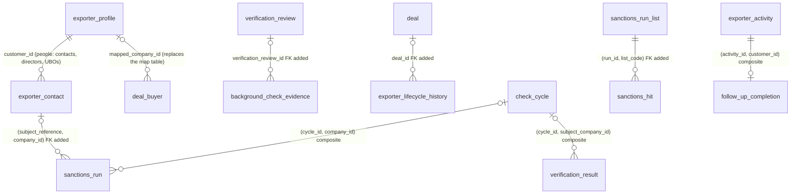

# CRM database audit — 3. Alternative designs and recommendation

**Part 3 of 4.** [1 Inventory](inventory.md) · [2 Audit](audit.md) ·
[3 Options](options.md) · [4 Migration plan](migration-plan.md)

Deliverable E. The opportunity ids (O1–O23) are defined in [audit.md §4.5](audit.md).
Nothing here has been implemented.

**Second-pass revision (12 October):** the recommended design is now the **optimised**
one below (32 tables). It replaces the first pass's "conservative" design (36 tables),
which added a new person table and kept three tables this pass removes.

---

## 1. The designs at a glance

| | **A. Optimised (recommended)** | B. Optimised + legacy buyer retired | C. Maximum merge (rejected) | D. Generic tables (rejected) |
|---|---|---|---|---|
| Idea | Retire the dormant legacy system. Put people in contacts. Fold one 1:1 table into its parent and move one lookup into code. Drop the unused placeholder. Retire superseded columns. Close the integrity gaps | A, plus archive and drop `deal_buyer` once no environment needs it | B, plus merge every 1:1 or derived table: follow-up completion, proposal resolution, sanctions run → result, trade relationship → invoice | C, plus one table each for all configuration, all decision chains and all evidence |
| `onboarding` tables | **32** | **31** | 27 | about 18 |
| New tables | 0 | 0 | 0 | 3 generic |
| Guarantees | All kept. 4 new FKs, 3 FKs made composite, 2 CHECKs, frozen configuration versions | As A | Loses append-only on activities and proposals. Sanctions runs take on frozen-result triggers they cannot satisfy. Trade routes are re-keyed | Loses most type-specific CHECKs and FKs |
| Risk | Low to medium. Additive first; every drop follows an archive and a read-only gate | Medium (touches legacy compliance evidence readers) | High | High |
| Recommended | **Yes** | Later, as an optional step | No | No |

---

## 2. Design A — optimised (recommended)

### 2.1 Table inventory

| Change | Tables | Count |
|---|---|---|
| Kept unchanged | `company_address`, `company_bank_account`, `exporter_activity`, `qualification_criterion`, `qualification_result`, `qualification_outcome`, `check_cycle`, `background_check_decision`, `background_check_proposal`, `background_check_proposal_resolution`, `verification_review`, `screening_review_item`, `sanctions_run_list`, `sanctions_disposition`, `deal`, `deal_required_document`, `crm_document`, `trade_relationship`, `trade_invoice`, `trade_invoice_outcome` | 20 |
| Kept, with column or constraint changes | `exporter_profile` (O4, O8), `exporter_gstin` (O5, O8), `exporter_contact` (**O2: becomes the people table**), `payment_term` (O9), `sanctions_list` (O9), `verification_result` (O3, O7, O19), `background_check_evidence` (O7), `exporter_lifecycle_history` (O7), `follow_up_completion` (O7), `sanctions_run` (O7, O2 FK), `sanctions_hit` (O7), `deal_buyer` (O21 columns, O6 freeze) | 12 |
| Merged into a parent | `deal_buyer_company_map` → `deal_buyer` (O21) | −1 |
| Moved into code | `qualification_reason_code` → `domain/qualification_reason_codes.py` (O20) | −1 |
| Dropped as unused | `bank_activity_finding` (O10) | −1 |
| Retired as legacy | The 14 tables in [audit.md §3.7](audit.md), plus 21 enum types (O1) | −14 |
| New | — | 0 |
| **Total** | 20 + 12 | **32** |

If the business keeps the legacy system (Q1), everything else still applies. The count
is then **46**, and the legacy tables simply stop being read.

### 2.2 People in `exporter_contact` (O2)

```sql
ALTER TABLE onboarding.exporter_contact
  ADD COLUMN is_contact               boolean NOT NULL DEFAULT true,
  ADD COLUMN is_director              boolean NOT NULL DEFAULT false,
  ADD COLUMN is_ubo                   boolean NOT NULL DEFAULT false,
  ADD COLUMN date_of_birth            date,
  ADD COLUMN nationality              varchar(2),
  ADD COLUMN residence_country        varchar(2),
  ADD COLUMN din                      varchar(8),      -- Director Identification Number (India)
  ADD COLUMN ownership_pct            numeric(5,2),
  ADD COLUMN control_type             varchar(24),
  ADD COLUMN identification_encrypted varchar(512),    -- the bank-account field cipher
  ADD COLUMN identification_last4     varchar(4),
  ADD COLUMN source                   varchar(64),     -- MANUAL, CSV, RXIL, LEGACY_UBO_RECORD
  ADD COLUMN source_ref               varchar(255),
  ADD CONSTRAINT ck_exporter_contact_has_role       CHECK (is_contact OR is_director OR is_ubo),
  ADD CONSTRAINT ck_exporter_contact_primary_is_contact CHECK (NOT is_primary_contact OR is_contact),
  ADD CONSTRAINT ck_exporter_contact_ownership_ubo  CHECK (ownership_pct IS NULL OR (is_ubo AND ownership_pct BETWEEN 0 AND 100)),
  ADD CONSTRAINT ck_exporter_contact_din            CHECK (din IS NULL OR (is_director AND din ~ '^[0-9]{8}$')),
  ADD CONSTRAINT ck_exporter_contact_nationality    CHECK (nationality IS NULL OR nationality ~ '^[A-Z]{2}$'),
  ADD CONSTRAINT ck_exporter_contact_residence      CHECK (residence_country IS NULL OR residence_country ~ '^[A-Z]{2}$'),
  ADD CONSTRAINT uq_exporter_contact_id_customer    UNIQUE (id, customer_id);
CREATE TRIGGER trg_exporter_contact_no_delete BEFORE DELETE ON onboarding.exporter_contact
  FOR EACH STATEMENT EXECUTE FUNCTION public.prevent_mutation();
ALTER TABLE onboarding.sanctions_run
  ADD CONSTRAINT fk_sanctions_run_subject_person
  FOREIGN KEY (subject_reference, company_id)
  REFERENCES onboarding.exporter_contact (id, customer_id) ON DELETE RESTRICT NOT VALID;
```

The field list is a draft for Q2. Whatever the fields turn out to be, the design keeps
these properties:

1. **One row per person per company.** A director who is also the main contact is not
   duplicated.
2. **The existing lifecycle applies.** `status` (ACTIVE, INACTIVE, LEFT_COMPANY) covers
   a director resigning or an owner selling out, so no second "active" flag is needed.
3. **Masking.** The new fields follow `api/schemas/masking.py`. `date_of_birth`, `din`
   and the identification number are masked unless the viewer holds the reveal
   permission (or a new one, per Q2).
4. **Real referential integrity.** A UBO or director run now references a person of
   the same company. Today that link is code-only.
5. **Legacy ids preserved.** `ubo_record` rows are copied with the same ids (source
   `LEGACY_UBO_RECORD`), so any existing run reference stays valid.

Readers that mean "contacts" add `is_contact`. These are the primary-contact lookup in
`deal_service`, the buyer contact created by `company_directory`, and the Contacts
panel. Readers that mean "people" (sanctions subjects, group suggestions) use
`is_director OR is_ubo`.

### 2.3 Buyer mapping on `deal_buyer` (O21)

```sql
ALTER TABLE onboarding.deal_buyer
  ADD COLUMN mapped_company_id uuid REFERENCES onboarding.exporter_profile (customer_id) ON DELETE RESTRICT,
  ADD COLUMN match_rule        onboarding.buyer_match_rule_enum,
  ADD COLUMN matched_by        varchar(255),
  ADD COLUMN matched_at        timestamptz,
  ADD COLUMN mapping_run_id    varchar(255),
  ADD CONSTRAINT ck_deal_buyer_mapping_complete CHECK (
    (mapped_company_id IS NULL) = (match_rule IS NULL)
    AND (mapped_company_id IS NULL) = (matched_at IS NULL)
    AND (mapped_company_id IS NULL) = (mapping_run_id IS NULL));
-- Freeze (O6): a function refusing INSERT, and refusing UPDATE of any column except
-- NULL -> value on the five mapping columns.
CREATE INDEX ix_deal_buyer_mapped_company ON onboarding.deal_buyer (mapped_company_id);
CREATE INDEX ix_deal_buyer_mapping_run    ON onboarding.deal_buyer (mapping_run_id);
```

The guarantees match the map table's:

- **One mapping per buyer:** the columns live on the buyer's own row.
- **A re-run creates nothing:** the command skips any row whose `mapped_company_id` is
  set.
- **A mapping is never changed:** set-once.
- **"What did run X do":** `ix_deal_buyer_mapping_run`.

`buyer_match_rule_enum` stays.

### 2.4 Reason codes in code (O20)

`domain/qualification_reason_codes.py` holds the 9 current rows exactly as they are
today, including the three retired by 0031 (`active = False`):

| Field | |
|---|---|
| `code` | |
| `label` | |
| `requires_note` | |
| `active` | |

- `GET /qualification/reason-codes` serves the catalogue.
- `qualification_service` validates an outcome's codes against it.
- A test asserts that every code ever stored in `qualification_outcome.reason_codes` is
  in the catalogue. This is the integrity the table never enforced with an FK.
- Future changes ship as code. They already ship as migrations today, so the cost of
  editing a code does not change.

### 2.5 One entry path for sanctions (O19, subject to Q9)

- The structured screening (`sanctions_run` → `sanctions_hit` → `sanctions_disposition`)
  becomes the only way to record a company's or a director's sanctions outcome.
- `POST /verifications` refuses `verification_type = SANCTIONS` for EXPORTER and
  DIRECTOR subjects. The screening service keeps writing the company summary result
  through `VerificationService`; that call is internal, not the route.
- The Clear rule, the handover guard and decision evidence are unchanged: they still
  read the summary `verification_result`.
- Existing hand-typed results stay valid history.
- Sample data moves to recording runs.
- A future provider adapter records runs, not bare results.

### 2.6 Entity-relationship changes (against [inventory.md §5.1](inventory.md))



Removed from the diagram:

- `deal_buyer_company_map`
- `qualification_reason_code` (it had no FK edges)
- `bank_activity_finding`
- the whole legacy cluster ([inventory.md §5.2](inventory.md))

No remaining CRM FK pointed at any of them except the map's, which moves.

### 2.7 Keys and constraints added or changed

| Table | Change |
|---|---|
| `exporter_contact` | Role and person columns, 6 CHECKs, `UNIQUE (id, customer_id)`, DELETE refused (§2.2) |
| `sanctions_run` | Composite FK to people; the cycle FK becomes `(cycle_id, company_id)` |
| `deal_buyer` | 5 mapping columns, a completeness CHECK, 2 indexes, and a freeze trigger (§2.3) |
| `background_check_evidence` | FK `verification_review_id`, plus a partial index |
| `exporter_lifecycle_history` | FK `deal_id` |
| `verification_result` | The cycle FK becomes `(cycle_id, subject_company_id)`. Drop `reviewed_by`, `review_status`, `evidence_reference` and `trg_verification_result_field_immutability` |
| `sanctions_hit` | FK `(run_id, list_code)` → `sanctions_run_list (run_id, code)` |
| `exporter_activity` | `UNIQUE (id, customer_id)` |
| `follow_up_completion` | The FK becomes `(activity_id, customer_id)` |
| `exporter_profile` | CHECK on `identity_type`; drop `relationship_manager` |
| `exporter_gstin` | CHECK on `state_code`; drop `address` |
| `payment_term`, `sanctions_list` | A set-once trigger on every column except `is_current`, `active` and `updated_at` |
| `deal` | `UNIQUE (company_id, reference)`, only if Q6 says so |

### 2.8 How each workflow works afterwards

| Workflow | Change |
|---|---|
| Lead → prospect → customer; gauges; history | None |
| Company identity (PAN, several GSTINs, registration number) | None. `identity_type` and `state_code` become checked by the database |
| GST branches and addresses | A branch's address is `address_id` only |
| RM, reviewer and collector assignment | The owner is only `relationship_manager_user_id`. The existing filters are unchanged |
| Contacts | Unchanged for the user. Rows gain role flags; the Contacts panel shows `is_contact` rows |
| Directors and UBOs | **New.** Recorded on the company's People view (the same table as contacts), masked. Adding one writes a history row, which drives "re-screen when a director or UBO is added" |
| Qualification | Reason codes come from code. Behaviour is identical |
| Background check, maker-checker, cycles | None. The new FKs make existing rules database-enforced |
| Verification and review | The review is read only from the chain. The legacy 409 path goes |
| Sanctions | Subjects are people rows. With Q9 = "runs only", the result can no longer be typed in by hand |
| Group suggestions | Read people instead of legacy tables |
| Deals and handover | No new `deal_buyer` rows. The buyer migration writes its outcome onto `deal_buyer` |
| Documents, trade history | None |
| Bank-activity panel | Shows "no feed connected" without an API call |
| Legacy `/onboarding/cases`, `/register`, Sumsub webhook | Removed (404) |

### 2.9 API contracts and ORM

**Removed or changed response fields:**

| Field | Where | Change |
|---|---|---|
| `relationship_manager` (text) | Exporter list and detail | Removed |
| GST `address` | GST registrations | Removed after one release returning both |
| `evidence_reference`, `reviewed_by`, `review_status` | Verification results | Removed |
| `GET /exporters/{id}/bank-activity` | — | Route removed |

**Added fields and routes:**

- Contact responses gain `is_contact`, `is_director`, `is_ubo` and the masked person
  fields.
- `POST /exporters/{id}/contacts` accepts the new fields.
- `GET /exporters/{id}/contacts?role=director|ubo|contact` is optional.

Regenerate `frontend/src/lib/api/schema.ts` and the OpenAPI artifact.

**ORM:**

- Delete the 14 legacy entity modules, their repositories and services, the workflow
  package, the KYB seed call and the `bootstrap.py` imports.
- Delete the 23 legacy test files and the `_LEGACY_ONBOARDING_TESTS` frozenset.
- Delete `DealBuyerCompanyMap`, `QualificationReasonCode` and `BankActivityFinding`.
- Extend `ExporterContact` and `DealBuyer`.
- Declare the 12 CHECKs that exist only in the database (O11).

Module boundaries are unchanged. Everything stays inside `onboarding`.

### 2.10 How audit, documents, assignments and history are preserved

- No append-only CRM table loses a row, and no table that carries history is dropped.
- Each retired value is recorded first:

| Retired value | Where it is kept |
|---|---|
| RM text | Matched names are backfilled. Unmatched names go to history rows, unless Q4 says to discard them |
| GST address | Converted into an address row, with history |
| Legacy review columns | Already in the chain since 0021. Checked per environment |
| Buyer mapping | Written onto `deal_buyer` instead of a separate table. Every created company still gets its `company_created_from_deal_buyer` history row |
| Reason codes | The same codes and labels, in code |
| Legacy tables | A `pg_dump --data-only` archive per environment, kept with the release record |

### 2.11 Trade-offs

**Gains:**

- 17 fewer tables (−35%) and 21 fewer enum types.
- No new table.
- One concept per word.
- Directors and UBOs finally recordable.
- One FK where today there is only code.
- One way to record sanctions.
- Nine fewer mounted routes.
- No `--crm` exclusion list.
- Schema documents that describe reality.

**Costs:**

- Contacts carry sensitive fields, so masking tests must cover them.
- The buyer-migration command and its tests change before it is first run.
- Four data steps need a person (Q4, Q5, Q7, Q9).
- Irreversible drops, mitigated by archives and read-only gates.

---

## 3. Design B — A, plus retiring `deal_buyer` (optional, later)

Once three things hold:

- the buyer migration has run in every environment (`mapped_company_id` set on every
  row);
- the `buyer` API field has been gone for a release;
- `compliance_inputs.buyer_inputs` (the legacy path) has no callers;

then:

1. Change `decision_evidence`'s seller-timeline union so it reads the
   `company_created_from_deal_buyer` history row's `deal_ids`, instead of joining
   `deal_buyer`.
2. Archive `deal_buyer` and drop it.

Legacy BUYER `verification_result.entity_reference` values then point at the archive.
That is acceptable because the column is already a polymorphic reference with no FK,
and `subject_company_id` carries the live link.

**Result: 31 tables.** Not part of the first approval, because it depends on every
environment's buyer migration.

---

## 4. Design C — maximum merge (rejected)

B, plus four further merges, each rejected in [audit.md §4.2](audit.md):

| Merge | Why it is rejected |
|---|---|
| `follow_up_completion` into activity | Activities stop being append-only. Architecture §9.3 names this as the mistake to avoid |
| `background_check_proposal_resolution` into proposal | Proposals become mutable, and a proposal ↔ decision FK cycle appears |
| `sanctions_run` into `verification_result` | A run's outcome changes as hits are decided, while a result freezes once reviewed. One company result summarises many runs |
| `trade_relationship` into invoices | Four routes and the frontend are re-keyed. Pairs with past trade but no invoice are lost |

Result: 27 tables. Each merge removes a table without removing a concept, and weakens
a guarantee.

## 5. Design D — generic tables (rejected)

One `config_item`, one `decision` and one `evidence` table, about 18 tables in all.
This drops the type-specific CHECKs and composite FKs that make the design safe: the
move CHECK, the chain-key self-FK, approver pinning, payment days per kind and
criterion shape. The brief's principle 7 ("avoid unnecessary abstraction") applies.

---

## 6. Comparison and recommendation

| Criterion | A | B | C | D |
|---|---|---|---|---|
| Correctness (rules the database enforces) | **Improves** | Improves | Regresses on 3 tables | Regresses widely |
| Real complexity removed | A second system; 5 duplicate concepts; 4 superseded columns; 2 sanctions entry paths | + the legacy buyer | + 4 tables whose facts become columns | Moves complexity into JSON |
| Fixes the missing entity | Yes, with no new table | Yes | Yes | Yes |
| Migration risk | Low to medium | Medium | High | High |
| Final tables | **32** | 31 | 27 | ~18 |

**Recommendation: Design A now, and Design B as a later optional step.** Design A is
the smallest schema in which:

- every remaining table is a distinct concept;
- every fact has one home;
- every rule the services rely on is also refused by PostgreSQL.

It removes 35% of the tables and adds none. Going further (C, D) trades the CRM's
compliance guarantees for a number.

If only part is approved, the order of value is:

| # | Steps | Why |
|---|---|---|
| 1 | O7, O8, O9, O11 | Integrity only; no data change |
| 2 | O21 | Must land before the buyer migration ever runs |
| 3 | O2 | Fixes a functional gap |
| 4 | O20, O10, O3 | Small, safe removals |
| 5 | O1 | The big reduction; needs Q1 |
| 6 | O4, O5, O19 | Need business answers |
| 7 | O24 | The squash: not now; once, at the CRM's separation |

**The squash.** It is not part of this programme. The refinement above runs as ordinary
migrations on the existing chain. The CRM's migrations are squashed into one baseline
file once, at the separation, when the chain holds only what the CRM keeps
(O24, migration-plan step 17). It changes no table, so every count above is unaffected.
